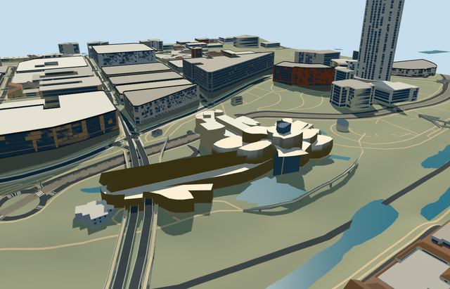

# guggenheim_museum_bilbao — Guggenheim Museum Bilbao

Reviewed 2026-10-21. **Source/model/LOD review complete. Native entrance fit remains unfinished; placement is an inactive draft.**

## Source and visual review

Specific asymmetric Guggenheim Bilbao museum: mapped long eastern gallery with two swept pointed fins; flared/leaning titanium masses and glazed crown, warm curved and angular limestone galleries, tall north river glazing/raised canopy/sloping pale support and south entry glazing/closed curved treads. Twenty mapped parts plus parent and separate overhead roof control the geometry. Removed overlapping lower gallery surfaces, attached entry glass to its actual parent edge and closed tread supports during this authoring pass. Three ordinary photographs viewed; independent bridge, promenade, surrounding buildings, pools, artwork and interiors excluded.

## Shared textures and browser budgets

Five existing 256px shared graphs across six roles: beadblasted stainless for titanium, coursed limestone for galleries and floor/steps, standing-seam metal for gallery roofs, storefront glass and painted metal for mullions/rails. No private atlas, new graph or embedded image. Shared renders request each graph once and release all model geometry on unload. Generic stainless approximates titanium optics; no bespoke panel texture.

| Level | Triangles | Bytes | Draws |
| --- | ---: | ---: | ---: |
| skyline | 624 | 58564 | 1 |
| district | 2950 | 249204 | 6 |
| street | 7513 | 588292 | 6 |
| closeup | 10432 | 834420 | 6 |

Four explicit authored LODs, each inside the medium-fi triangle/draw budget. Initial skyline plus district: 307,768 bytes; six textured near draws and one flat skyline draw. POSITION and NORMAL use separate buffer views and CPU/GPU accounting matches. 43 current source/shared/lighting/LOD/native views inspected, plus 176 geometry/contact probes over six GLBs. Physical laptop/phone/tablet and dense-city timings remain pending. Flat synthetic views do not approve real-world grade.

## Native placement remains pending

Placement remains inactive draft. Q179199/OSM way118499485version 50 and its 20 integrated mapped parts, plus raised museum canopy way118506112v6, establish the 22 owned native records. Native east/south coordinates, heading 0, east gallery/+X, south entry/+Z and river/-Z retained. 40 actual overlapping PMTiles13/14/15 cases pass. 365 resident records become 343 unchanged independent records on success; all 365 survive load failure. Original 201 × 201 / 6 m terrain, roads, river/pools (171,565 m²) and all 514 wider independent records remain. Uncovered provider [20,50] gives modelWorldY approximately 0; each unload restores ground/water/zero live geometry. However, coarse native terrain exposes an excessive front retaining face at the reconstructed curved entry stairs. This is not accepted as native fit; no custom DEM or precinct flattening.

## Limits

Medium-fi source silhouette/material/LOD review complete, with reconstructed shell flare, roof slopes, mullion inventory, entry stair shape/count and 9.7 m working absolute floor. Exact CAD profiles, panel inventory, interior layout and historical/current accessibility not verified. Native entry placement remains unfinished; the source is not counted as a completed candidate.

## Checks

Six GLBs, zero Khronos errors/warnings; 176 geometry/contact probes; 40 map-overlap cases; 43 current inspected frames. Selected generation/import/draft placement, strict medium-fi, scene/sim and lint checks recorded in local completion report. Sim30 sha256:ab90d3ab95c7ac3497814a0b9919436586578d48d937ba689097db184777cf07. Current hash bindings: [qa.json](qa.json). Editable geometry controls: [map-frame.json](map-frame.json).

## Viewed references

- https://commons.wikimedia.org/wiki/File:Guggenheim_Museum_Bilbao_(5736586558).jpg — David Baron; 2011-05-15; CC-BY-SA-2.0. Viewed only, no copied pixels.

- https://commons.wikimedia.org/wiki/File:Guggenheim_Bilbao_06_2012_Panorama_2680.jpg — Mariordo (Mario Roberto Duran Ortiz); 2012-06-01; CC-BY-SA-3.0. Viewed only, no copied pixels.

- https://commons.wikimedia.org/wiki/File:Museo_Guggenheim_Bilbao-at_entrance.jpg — Xauxa (Hakan Svensson); 2011-10-30; CC-BY-SA-3.0. Viewed only, no copied pixels.

- https://www.openstreetmap.org/way/118499485 — named museum/Q179199,version 50.

- https://www.openstreetmap.org/way/118506112 — raised museum roof,version 6, min_level 6. ©OpenStreetMap contributors,ODbL1.0.
