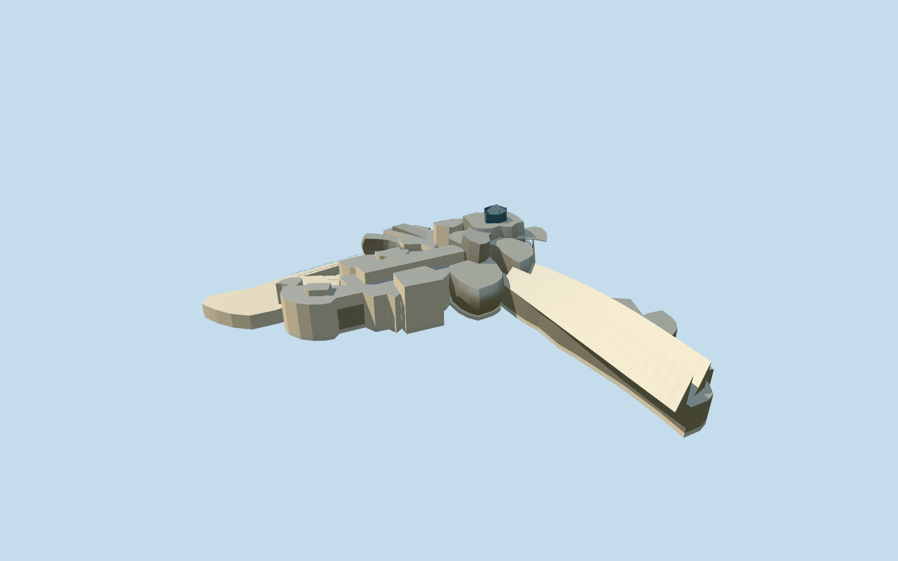

# Guggenheim Museum Bilbao

Guggenheim Bilbao’s titanium shells, limestone galleries, eastern fins, lantern and river canopy, with the lower glazed entrance, 41-step city-side stair, western promenade flight and bounded entrance paving.

## Evidence and reconstruction

Published dimensions and reconstructed details are separated in spec.json. Primary references:

- [Reference](https://commons.wikimedia.org/wiki/File:Guggenheim_Museum_Bilbao_(5736586558).jpg)
- [Reference](https://commons.wikimedia.org/wiki/File:Guggenheim_Bilbao_06_2012_Panorama_2680.jpg)
- [Reference](https://commons.wikimedia.org/wiki/File:Museo_Guggenheim_Bilbao-at_entrance.jpg)
- [Reference](https://pro.guggenheim-bilbao.eus/en/the-building/outside-the-museum)

Guggenheim Bilbao’s titanium shells, limestone galleries, eastern fins, lantern and river canopy, with the lower glazed entrance, 41-step city-side stair, western promenade flight and bounded entrance paving.

## Model and axes

12,703 triangles; 32,851 vertices; 6 material groups; 1,339,008 bytes. Native bounds: -109.723, -5.691, -56.444 to 118.075, 36.719, 128.860. Source hash: `sha256:d59829d116f9a5064f0e346e6c12c8c097544ef5aad20b2a2cfad9646a043be8`.

{"x":"east","y":"up","z":"south"}

The geographic proposal uses exact-QID OpenStreetMap evidence. Map-derived orientation and estimated architectural details require real-site visual review; preview eligibility is distinct from geographic/fidelity approval. Map attribution: © OpenStreetMap contributors, ODbL-1.0.

## Reproduce

Run `node packages/worldgen/scripts/generate-additional-landmarks.mjs --ids=guggenheim_museum_bilbao` (or add `--check`). The generator preserves manually edited masters by checking their baseline hashes. Import through the standard authored-model workflow with optimization disabled; then capture all QA cameras, including shared-surface views.

## Pending work

- The entrance and plaza elevations, intermediate tread dimensions and west stair count are fitted from ordinary photographs and the standard terrain. Exterior accessibility hardware and exact elevation survey remain outside this reconstruction.
- The museum exterior retains photo-led shell profiles, gallery heights and joints. La Salve Bridge, independent artworks and museum interiors remain separate.

This bundle follows the medium-fi standard. Medium-fi appearance and geographic fit are reviewed separately. Hash-bound visual acceptance is recorded separately after capture inspection.
