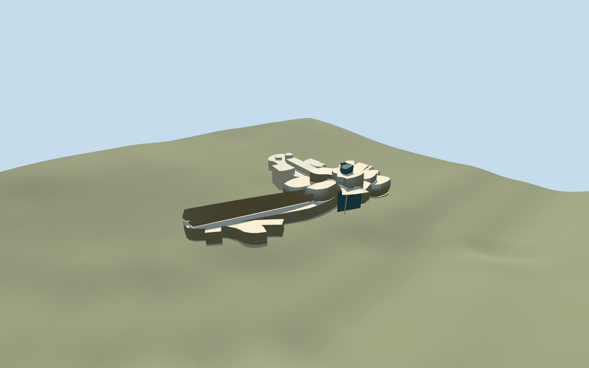

# Guggenheim Museum Bilbao

Guggenheim Museum Bilbao: complete mapped asymmetric museum with long eastern fish-like gallery and pointed roof fins, clustered flared/leaning titanium lobes, 41m central lantern, tall river-facing glazed atrium and raised canopy, warm limestone south/west gallery ranges and curved entrance steps. Specific mapped parts guide plan/height; curved shell profiles, mullion inventory and hidden roofs are picture-led approximations. Independent La Salve bridge, surrounding buildings, promenade, pools and contemporary artworks are excluded.

## Evidence and reconstruction

Published dimensions and reconstructed details are separated in spec.json. Primary references:

- [Reference](https://commons.wikimedia.org/wiki/File:Guggenheim_Museum_Bilbao_(5736586558).jpg)
- [Reference](https://commons.wikimedia.org/wiki/File:Guggenheim_Bilbao_06_2012_Panorama_2680.jpg)
- [Reference](https://commons.wikimedia.org/wiki/File:Museo_Guggenheim_Bilbao-at_entrance.jpg)

Guggenheim Museum Bilbao: complete mapped asymmetric museum with long eastern fish-like gallery and pointed roof fins, clustered flared/leaning titanium lobes, 41m central lantern, tall river-facing glazed atrium and raised canopy, warm limestone south/west gallery ranges and curved entrance steps. Specific mapped parts guide plan/height; curved shell profiles, mullion inventory and hidden roofs are picture-led approximations. Independent La Salve bridge, surrounding buildings, promenade, pools and contemporary artworks are excluded.

## Model and axes

10,432 triangles; 27,016 vertices; 6 material groups; 1,101,692 bytes. Native bounds: -103.351, -5.691, -56.444 to 118.075, 38.369, 102.701. Source hash: `sha256:6aff3cd0b38fc5aa51fbb1e153d54237708b6c294ee0c3db408cd6a129aaff06`.

{"x":"east","y":"up","z":"south"}

The geographic proposal uses exact-QID OpenStreetMap evidence. Map-derived orientation and estimated architectural details require real-site visual review; preview eligibility is distinct from geographic/fidelity approval. Map attribution: © OpenStreetMap contributors, ODbL-1.0.

## Reproduce

Run `node packages/worldgen/scripts/generate-additional-landmarks.mjs --ids=N0746` (or add `--check`). The generator preserves manually edited masters by checking their baseline hashes. Import through the standard authored-model workflow with optimization disabled; then capture all QA cameras, including shared-surface views.

## Pending work

- Guggenheim Museum Bilbao: complete mapped asymmetric museum with long eastern fish-like gallery and pointed roof fins, clustered flared/leaning titanium lobes, 41m central lantern, tall river-facing glazed atrium and raised canopy, warm limestone south/west gallery ranges and curved entrance steps. Specific mapped parts guide plan/height; curved shell profiles, mullion inventory and hidden roofs are picture-led approximations. Independent La Salve bridge, surrounding buildings, promenade, pools and contemporary artworks are excluded.
- Q179199 and named museum OSM way118499485 v50/native35184490588317. Standard Protomaps20261020 detailed parent and20 integrated building parts; independently mapped overhead atrium canopy way118506112 v6/building=roof/min_level6 belongs to the museum, with original ground retained beneath it. All other native records retained. East arm is +X; main entrance is south/+Z and river front is north/-Z. Heading0 with full geographic east/south controls.
- Mapped body11m and distinct part heights17/20/23/26/29/32/35/41m retained as silhouette controls above working museum floor9.7m absolute. Canopy is raised16..23m above that floor. Titanium flare/lean/top slopes and glass roof profiles are approximate reconstructions from three ordinary pictures, not exact CAD/survey. Entrance has a reconstructed curved descending flight to the lower museum level; accessibility and hidden interiors unverified.
- Standard unmodified Mapzen6m grid retained. Uncovered provider[20,50] datum11.708888888888884m; level museum floor9.7m absolute. Foundation below local lowest boundary, occupied parent ground opening sealed by the model floor in every LOD. Overhead canopy ground, independent buildings, roads, pools and river remain original; no precinct flattening or bespoke terrain. Coarse grade and absolute floor are approximate and require current native render review.

This bundle follows the medium-fi standard. Medium-fi appearance and geographic fit are reviewed separately. Hash-bound visual acceptance is recorded separately after capture inspection.
