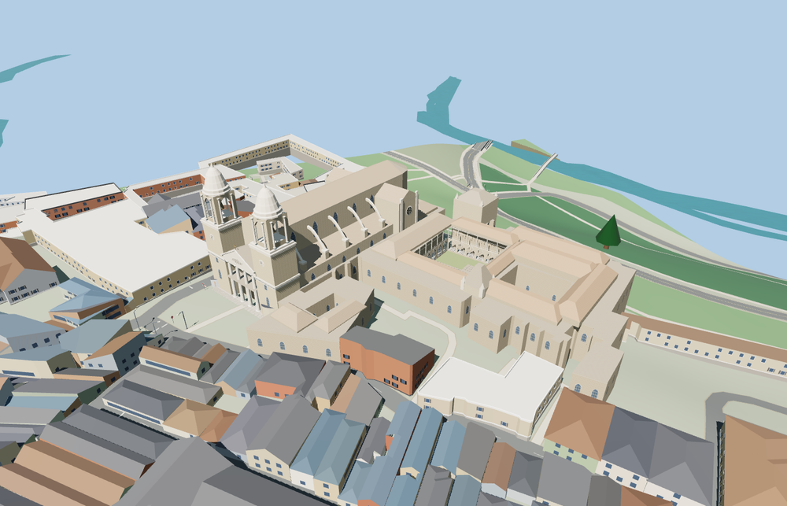

# Pamplona Cathedral

The Neoclassical façade has an open four-column porch and two open bell chambers. The Gothic nave has flying buttresses, a polygonal apse and transept roses. The connected range retains three open spaces, including the cloister with carved arcade and upper gallery.

The 26,126-triangle source rebuilds byte for byte. Skyline, district, street and close-up use 991, 3,724, 11,687, 26,090 triangles. Skyline and district total 366,052 bytes. Six GLBs validated and 36 current views were inspected.

All four tiers pass roof, court, stair, wall, porch, bell chamber and cloister opening probes. The viewer retains 401 independent buildings, 121 transportation records, and all 2 native water records in the review area. The original cathedral shell remains available on failed loading.

The mapped cathedral relation defines the complex perimeter and three voids. The historic façade and nave axis use the plaza, map outline and exterior photographs. Roof profiles, tower heights, sculpture, buttresses, cloister tracery and ground levels are exterior reconstructions from photos and standard terrain. The main cloister has an open walk with simplified tracery and stonework. The model covers the connected exterior ensemble. Full church interiors, bells in motion, interior chapels and occupied museum rooms are outside this reconstruction.

Rebuild with `node packages/worldgen/scripts/generate-pamplona-cathedral.mjs`. Append `--check` to compare exact bytes. Use `--ids=pamplona_cathedral` for targeted import, LOD, placement and readiness.
