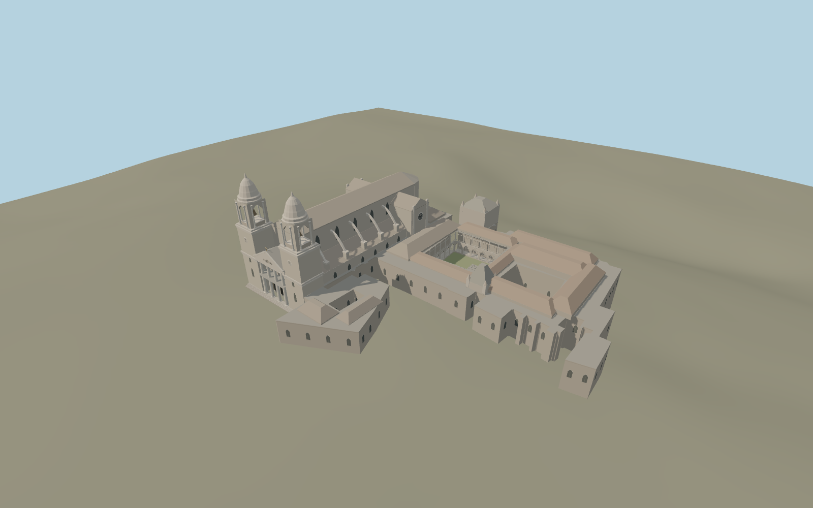

# Pamplona Cathedral

The Neoclassical façade has an open four-column porch and two open bell chambers. The Gothic nave has flying buttresses, a polygonal apse and transept roses. The connected range retains three open spaces, including the cloister with carved arcade and upper gallery.

Run `node packages/worldgen/scripts/generate-pamplona-cathedral.mjs` to rebuild the source master. Append `--check` to compare the exact bytes. Use `--ids=pamplona_cathedral` for targeted import, LOD generation and placement.

The mapped cathedral relation defines the complex perimeter and three voids. The historic façade and nave axis use the plaza, map outline and exterior photographs.

Roof profiles, tower heights, sculpture, buttresses, cloister tracery and ground levels are exterior reconstructions from photos and standard terrain. The main cloister has an open walk with simplified tracery and stonework.

The model covers the connected exterior ensemble. Full church interiors, bells in motion, interior chapels and occupied museum rooms are outside this reconstruction.

Original geometry follows the repository license. Map data is © OpenStreetMap contributors under ODbL-1.0 via Protomaps. Terrain samples are described in terrain-grid.json. Ordinary pictures stay local and are not redistributed or used as textures. Current acceptance is recorded in qa.json.
