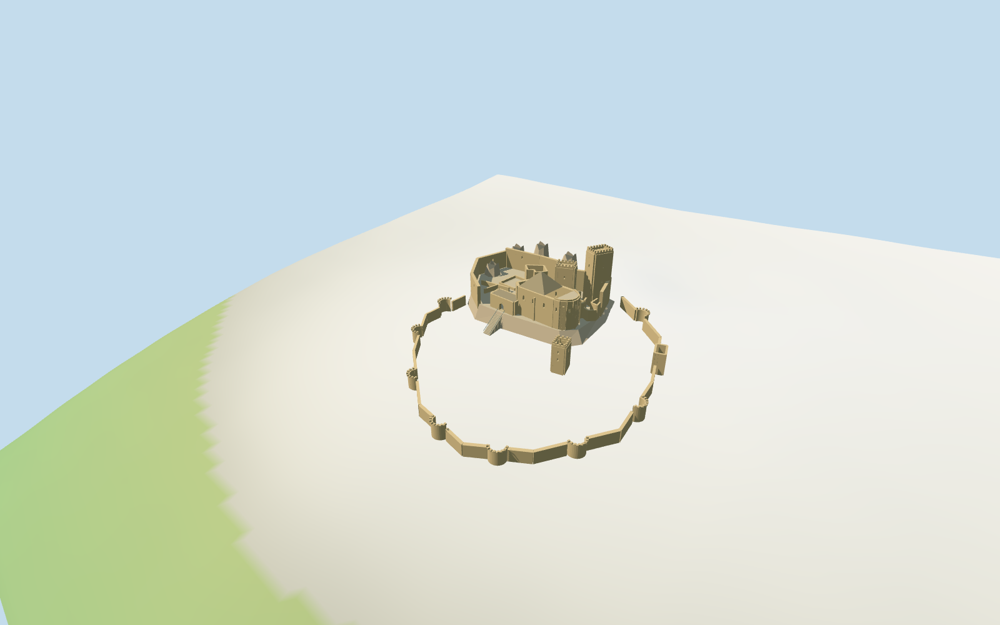

# Loarre Castle

Individual Loarre rocky fortress: unequal square keeps, roofless western and northern ranges, open court and crag, mapped chapel with tall polygonal stone roof and rounded eastern terrace, lower entrance/stairs, detached slim tower, and sloping lower curtain with hollow open-backed semicircular towers and an arched gate.

## Evidence and reconstruction

Published dimensions and reconstructed details are separated in spec.json. Primary references:

- [Reference](https://www.romanicoaragones.com/colaboraciones/LoarreAereas%20G14.jpg)
- [Reference](https://www.romanicoaragones.com/colaboraciones/LoarreAereas%20G03.jpg)

Five existing256-square graphs supply coursed limestone, continuous limestone crag, stone-colored roof, courtyard paving and painted metal; geometry uses metric UVs and linear tints. No unique bitmap or embedded photograph.

## Model and axes

6,723 triangles; 20,169 vertices; 5 material groups; 810,196 bytes. Native bounds: -38.995, -17.403, -41.469 to 73.955, 29.600, 79.265. Source hash: `sha256:5b848542bbc5b1de81feba1301d7458f3c792e3bcd8c93c8128f287215dd125f`.

{"x":"eastward along chapel nave to rounded apse","y":"up","z":"southward/downhill toward lower enclosure"}

Named PMTiles castle/chapel POIs and seven current component plans support approximate correspondence and signed chapel facing. Neither exact-QID outer walls nor surveyed dimensions are claimed. Pictures supply the lower curtain and rock treatment; heights and terrain joins remain estimates. © OpenStreetMap contributors, ODbL-1.0.

## Reproduce

Run `node packages/worldgen/scripts/generate-additional-landmarks.mjs --ids=loarre_castle` (or add `--check`). The generator preserves manually edited masters by checking their baseline hashes. Import through the standard authored-model workflow with optimization disabled; then capture all QA cameras, including shared-surface views.

## Pending work

- Mapped components fix approximate plan and signed facing; neither exact-QID outer enclosure nor surveyed orientation is claimed.
- Lower curtain, gate position, upper curtain, rock forms, wall thicknesses, stair profiles and tower heights are estimates from two exterior pictures and coarse viewer DEM.
- Full interiors, archaeological chronology, site vegetation and certified walkable collision are excluded.
- Upper crag cap and foundation contacts approximate the terrain blended by coarse DEM; no terrain carving or survey accuracy is claimed.
- Physical laptop and phone frame-rate measurements remain pending.

This bundle follows the medium-fi standard. Medium-fi appearance and geographic fit are reviewed separately. Hash-bound visual acceptance is recorded separately after capture inspection.

## Additional geographic data

© OpenStreetMap contributors; Protomaps; Mapzen/USGS terrain tiles.
