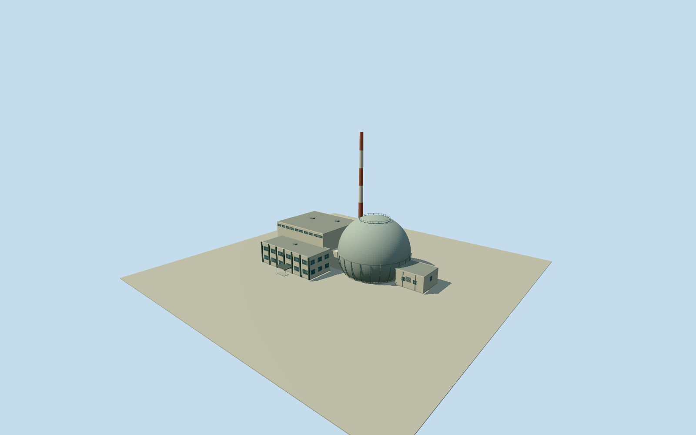

# Big Rock Point Nuclear Power Plant

Representative circa1963historical Big Rock Point principal station exterior: clipped spherical steel containment, equatorial rim/outer ribs/crown walkway and curved access ladder, tapered red/white striped stack, attached high flat-roof turbine hall/clerestory, front two-storey glazed pier block/canopy and intrinsic shoreward water building/short service connection. No plant internals, modern spent-fuel yard or landscape. Photographic plan/sections and colors are estimates; historical-only.

Authoring state: **review-in-qa.json**. Current completion evidence is in [qa.json](qa.json) and the [completion ledger](../../../../qualla-structures/batches/qualla-002.PROGRESS.md).

- [Big Rock Point Nuclear Power Plant](https://qualla.com/big-rock-point-nuclear-power-plant/)

Former plant identity Q836568/CC0native Wikidata coordinate45.3589N,85.1972W, distinct from the Qualla roadside-marker coordinate45.36277777777778N,85.17555555555556W about1.75km east. Exact native BigRockRoadway17761137provides site access context only; no surviving plant roof polygon exists. Do not place the old station at the marker or adopt current storage/roads as its plan. Whole station plan/heading/module positions interpreted from DOEaerial/front/shoreward photographs. Local+Xapproximately southeast across station front, +Zsouthwest away from lake. Registration at the four-decimal former-plant coordinate is approximate, not a surveyed native roof match. Sphere nominal130ftdiameter/102ftvisible height and stack240ftheight control scale; other sections/positions are estimates.

Historical representative circa1963appearance only, with1963-01-01through1964-01-01viewing range. DOE archive photos are undated;1963is an interpretation of early-operation configuration, not their exposure date or proof of unchanged later years. Original station demolished; never current-world eligible.

Three exact already-published QuallaDOE exterior originals/native SHA1s and primary PD-USGov-DOE/ENERGY.GOVreviewed government-work releases bind all reference imagery. Generated Qualla categories omit the grant, recovered through exact primary proof without editing media metadata. Interior/fish images, modern marker artwork, attribution-licensed1970/NRCphotos and postcards unused. No generated bitmap or copied image pixels.

Nominal130ftdiameter shell/28ftburied/102ftvisible and240ftstack are owner text controls. Above-grade clipped spherical shell preserves inward-curving lower profile, rim/ribs/crown walkway/ladder, seven alternating broad stack bands, attached tall turbinehall/clerestory, lower front glazed pier block/canopy and shoreward cooling-water building. Module dimensions/bearing/hidden sections/window counts/roof vents/ribs/crown details are bounded photographic estimates. Muted blue-green shell and pale walls are material estimates from monochrome; red/white stack is confirmed by owner text. No engineering/interior/operational replica claim.

Switchyard/powerlines, detached sheds, parking/roads, vegetation, shoreline riprap/lake, people/vehicles/lettering, modern marker and spent-fuel storage excluded. No whole-site slab. Fixed independent modern Terrarium field remains unchanged; restored shore/greenfield differs from historic station grading. Exact historical ground/foundation/host attachment unverified.

Build: `node packages/worldgen/scripts/generate-authored-places.mjs --ids=big_rock_point_nuclear_power_plant`. Add `--check` to verify exact regeneration. 19624 triangles; 5 materials; no embedded photographs.
