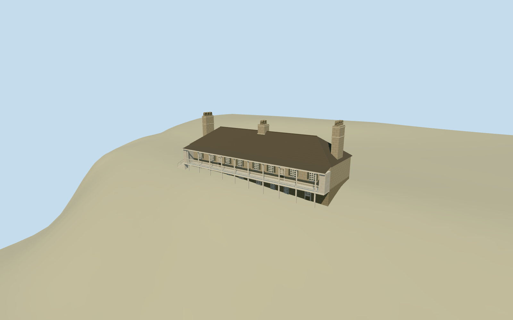

# Fort Mackinac Officers’ Stone Quarters

The original Officers’ Stone Quarters with its three chimney stacks and timber gallery above Mackinac Harbor.

Authoring state: **review-in-qa.json**. Current completion evidence is in [qa.json](qa.json) and the [completion ledger](../../../../qualla-structures/batches/qualla-004.PROGRESS.md).

- [Fort Mackinac](https://qualla.com/fort-mackinac/)

The structure covers the original stone quarters and attached galleries. The surrounding fort walls, gate, and separate officers’ buildings are outside the model footprint.

Window trim, shutters and masonry follow the measured elevations and the public-domain historic photograph. Present-day paint and exact mortar pattern are approximate.

Build: `node content/worldgen/source/places/f0/f05/fort_mackinac_officers_stone_quarters/models/generate-fort-mackinac-officers-stone-quarters.mjs`. Add `--check` to verify exact regeneration. 6742 triangles; 6 materials; no embedded photographs.
