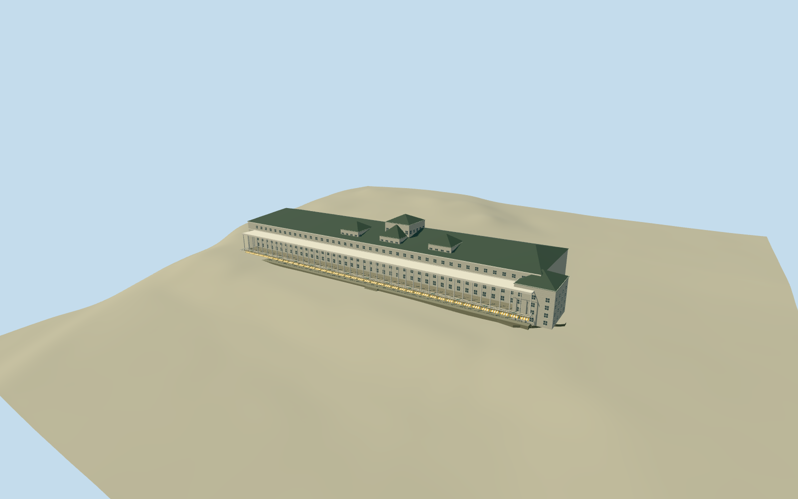

# Grand Hotel (Mackinac Island)

Mackinac Island’s long white hotel, with its Doric waterfront veranda, striped awnings, green roof and central cupola.

Authoring state: **review-in-qa.json**. Current completion evidence is in [qa.json](qa.json) and the [completion ledger](../../../../qualla-structures/batches/qualla-004.PROGRESS.md).

- [Grand Hotel (Mackinac Island)](https://qualla.com/grand-hotel-mackinac-island/)

The connected hotel and its current exterior are in scope. Furnishings, grounds, independent service buildings and signage are excluded.

Porch extent follows the mapped building and its end returns. Published survey and promotional lengths use differing measurements. Dimensions of smaller windows, rear connections and roof fittings are estimates.

Build: `node content/worldgen/source/places/f0/f05/grand_hotel_mackinac_island/models/generate-grand-hotel-mackinac-island.mjs`. Add `--check` to verify exact regeneration. 52318 triangles; 6 materials; no embedded photographs.
