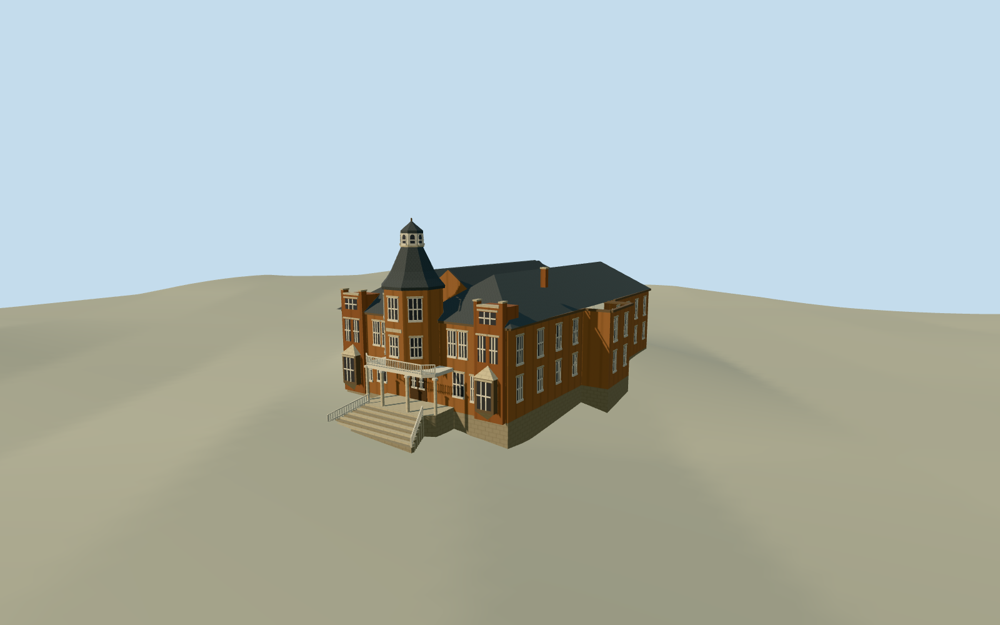

# Finnish Labour Temple

The early Finnish Labour Temple with the original octagonal lantern, twin hipped roofs, symmetrical brick bays and wide Bay Street steps below a balustraded porch.

Authoring state: **review-in-qa.json**. Current completion evidence is in [qa.json](qa.json) and the [completion ledger](../../../../qualla-structures/batches/qualla-004.PROGRESS.md).

- [Finnish Labour Temple](https://qualla.com/finnish-labour-temple/)

This is the early 1910 exterior. The original hall burned in December 2021 and its remains were cleared in 2022.

Rear elevation and roof transitions use the prefire outline with interpreted openings. Early masonry color, minor details and heights are estimated from archival prints.

Build: `node content/worldgen/source/places/f0/f08/finnish_labour_temple/models/generate-finnish-labour-temple.mjs`. Add `--check` to verify exact regeneration. 8008 triangles; 6 materials; no embedded photographs.
