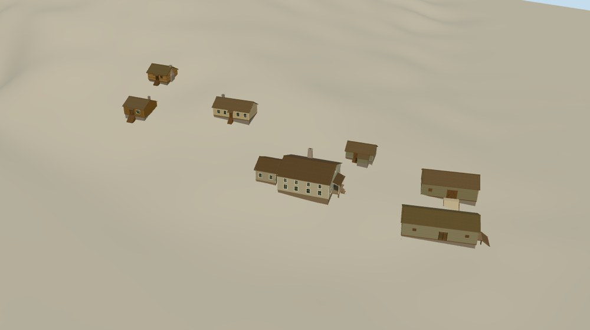

# Fort Témiscamingue

Seven separate exteriors represent the late trading and administrative core at Obadjiwan Point in 1888. They include both stores, the factor’s and clerk’s residences, the blacksmith and carpentry workshops, and the dairy and icehouse. Molen shows them as dated placements, and Qualla links to each asset.

The site review uses an unchanged 512 m Terrarium field, the existing placement coordinates and headings, and the independently sampled ground datum of each asset. Vertical contact remains approximate at this DEM resolution. The source field represents the modern terrain. The historic ground registration and several elevations remain approximate. The 1876 photograph and written archaeological evidence guide the historical reconstruction.

[Fort Témiscamingue story](https://qualla.com/fort-t-miscamingue/)

Regenerate the assembly with `node content/worldgen/source/places/f0/f0r/fort_temiscamingue/generate-collection-scene.mjs`. Use `--check` to verify the current assembly.
