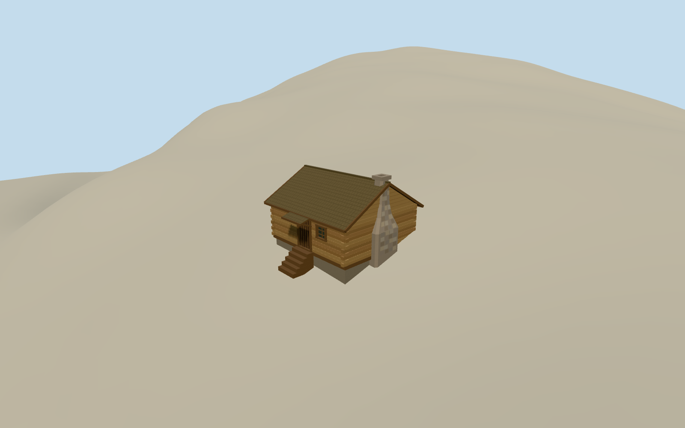

# Fort Témiscamingue Blacksmith Forge

A reconstruction of the late Hudson’s Bay Company blacksmith forge, with squared timber courses, west entry canopy and south masonry fireplace.

Authoring state: **review-in-qa.json**. Current completion evidence is in [qa.json](qa.json) and the [completion ledger](../../../../qualla-structures/batches/qualla-003.PROGRESS.md).

- [Fort Temiscamingue: Where the Cedars Dance at the Narrows](https://qualla.com/fort-t-miscamingue/)

The post is depicted in 1888. The regional placement is visible in the historical date range.

The excavated width and length govern the walls. Ridge height, opening sizes, awning construction and visible chimney profile are estimates.

The original modern source ground rises from shore to terrace across the footprint. The foundation and threshold are adapted to that ground, and original late nineteenth-century contact is approximate.

The 1876 public-domain photograph provides site character and distant exterior context. Precise forge detail comes from the archaeological description.

Build: `node content/worldgen/source/places/f0/f0r/fort_temiscamingue_blacksmith_forge/models/generate-fort-temiscamingue-blacksmith-forge.mjs`. Add `--check` to verify exact regeneration. 2898 triangles; 5 materials; no embedded photographs.
