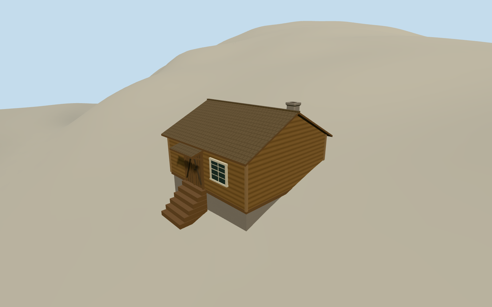

# Fort Témiscamingue Carpentry Workshop

Roy identifies the carpenter’s workshop as building 8 in the 1888 plan. The current rectangle and the Qualla view give approximate scale and overall timber appearance. The workshop doorway, light windows and small chimney are interpreted.

Authoring state: **review-in-qa.json**. Current completion evidence is in [qa.json](qa.json) and the [completion ledger](../../../../qualla-structures/batches/qualla-003.PROGRESS.md).

- [Fort Temiscamingue: Where the Cedars Dance at the Narrows](https://qualla.com/fort-t-miscamingue/)

Quebec’s archaeological inventory locates the shop immediately west of the second forge. The modern mapped reconstruction west of the forge supplies a bounded estimate for the position and alignment.

Roy identifies the carpenter’s workshop as building 8 in the 1888 plan. The current rectangle and the Qualla view give approximate scale and overall timber appearance. The workshop doorway, light windows and small chimney are interpreted.

The original terrain comes from the modern source grid. The foundation and access are interpreted to fit that terrain. Details and proportions are approximate.

Build: `node content/worldgen/source/places/f0/f0r/fort_temiscamingue_carpentry_workshop/models/generate-fort-temiscamingue-carpentry-workshop.mjs`. Add `--check` to verify exact regeneration. 590 triangles; 5 materials; no embedded photographs.
