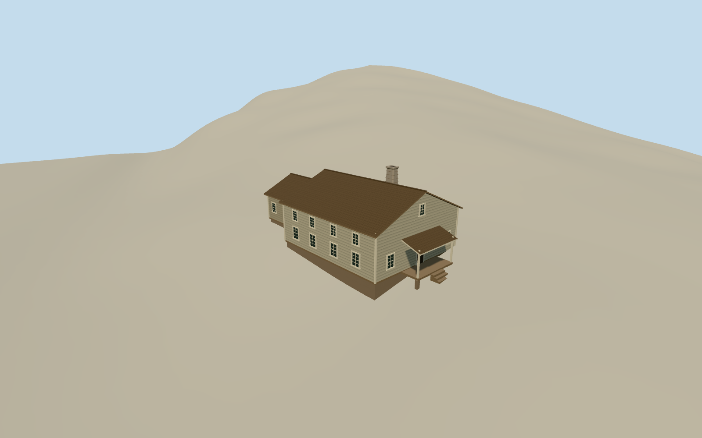

# Fort Témiscamingue Chief Factor’s House

The late Hudson’s Bay Company Chief Factor’s House, with a covered link to the rear annex and a masonry chimney.

Authoring state: **review-in-qa.json**. Current completion evidence is in [qa.json](qa.json) and the [completion ledger](../../../../qualla-structures/batches/qualla-003.PROGRESS.md).

- [Fort Temiscamingue: Where the Cedars Dance at the Narrows](https://qualla.com/fort-t-miscamingue/)

The written archaeology identifies a principal residence and a rear block linked by a central passage. The current house ruin footprint matches that arrangement approximately. The 1888 catalog pose and anteroom dimensions are estimates.

The mapped shape suggests a shorter porch on the south face. Its shape, timber details, roof pitch, storey heights and window arrangement are reconstructed.

The lower western threshold uses the current Terrarium grade reference. The eastern slope and taller rear footing approximate contact with the unchanged modern terrain.

The published 1876 view supports the post’s pale principal timber buildings and massing. The surviving chimney is identified in the regional archaeological guide.

Build: `node content/worldgen/source/places/f0/f0r/fort_temiscamingue_chief_factors_house/models/generate-fort-temiscamingue-chief-factors-house.mjs`. Add `--check` to verify exact regeneration. 2802 triangles; 5 materials; no embedded photographs.
