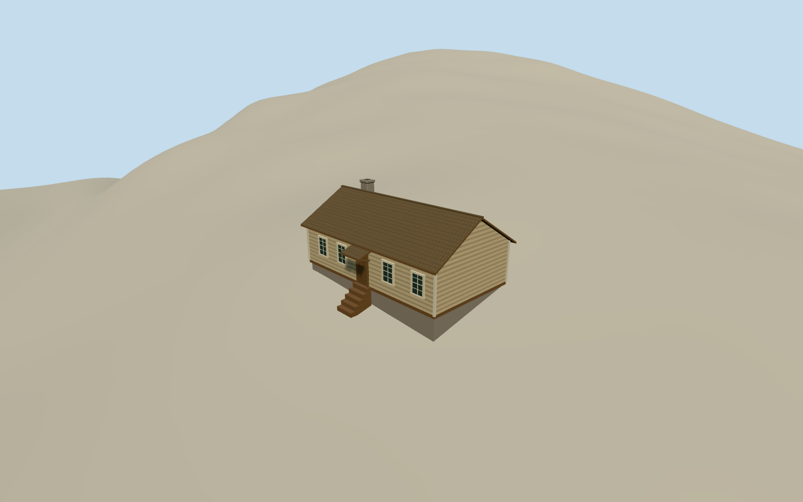

# Fort Témiscamingue Clerk’s House

The 1888 plan supplies the identity, and the Parks Canada field reports confirm the clerk’s residence. The distant Qualla photograph and Julian Ralph’s period description of HBC clerks’ lodgings guide a low pale log dwelling, with an estimated entrance and hearth.

Authoring state: **review-in-qa.json**. Current completion evidence is in [qa.json](qa.json) and the [completion ledger](../../../../qualla-structures/batches/qualla-003.PROGRESS.md).

- [Fort Temiscamingue: Where the Cedars Dance at the Narrows](https://qualla.com/fort-t-miscamingue/)

The excavation records identify the clerk’s house as building 9 and place the flagstaff between it and the factor’s house. The house is estimated 9 m east and 35 m north of that house in the administrative group.

The 1888 plan supplies the identity, and the Parks Canada field reports confirm the clerk’s residence. The distant Qualla photograph and Julian Ralph’s period description of HBC clerks’ lodgings guide a low pale log dwelling, with an estimated entrance and hearth.

The original terrain comes from the modern source grid. The foundation and access are interpreted to fit that terrain. Details and proportions are approximate.

Build: `node content/worldgen/source/places/f0/f0r/fort_temiscamingue_clerks_house/models/generate-fort-temiscamingue-clerks-house.mjs`. Add `--check` to verify exact regeneration. 974 triangles; 5 materials; no embedded photographs.
