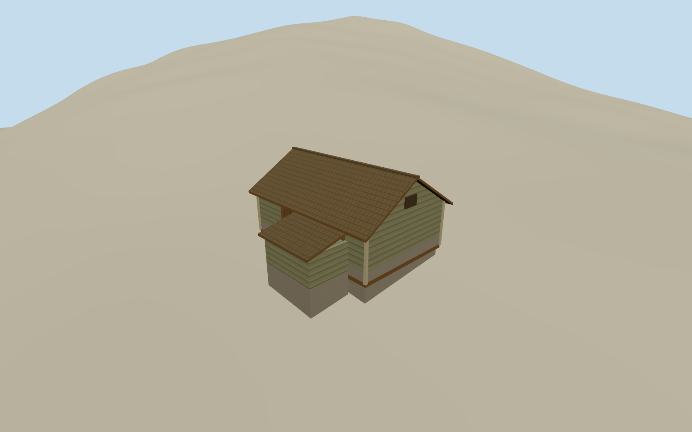

# Fort Témiscamingue Dairy and Icehouse

Parks Canada identifies a dairy and icehouse, and its field report records an excavated icehouse. The reconstruction is a low timber structure with a stone base, a main storage chamber and attached service section. The exact plan and finish are estimates.

Authoring state: **review-in-qa.json**. Current completion evidence is in [qa.json](qa.json) and the [completion ledger](../../../../qualla-structures/batches/qualla-003.PROGRESS.md).

- [Fort Temiscamingue: Where the Cedars Dance at the Narrows](https://qualla.com/fort-t-miscamingue/)

The Parks Canada inventory places the dairy east of the factor’s house. The historic group is estimated 19 m east and 3 m south of the house’s center.

Parks Canada identifies a dairy and icehouse, and its field report records an excavated icehouse. The reconstruction is a low timber structure with a stone base, a main storage chamber and attached service section. The exact plan and finish are estimates.

The original terrain comes from the modern source grid. The foundation and access are interpreted to fit that terrain. Details and proportions are approximate.

Build: `node content/worldgen/source/places/f0/f0r/fort_temiscamingue_dairy_and_icehouse/models/generate-fort-temiscamingue-dairy-and-icehouse.mjs`. Add `--check` to verify exact regeneration. 422 triangles; 5 materials; no embedded photographs.
