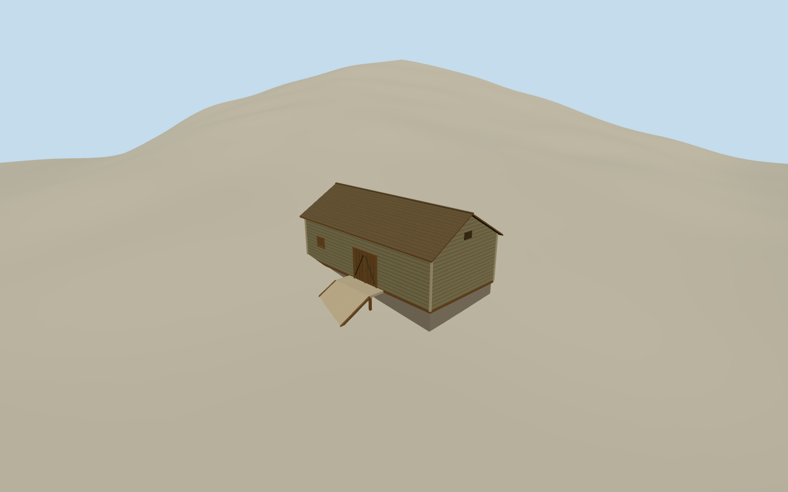

# Fort Témiscamingue Eastern Storehouse

The 1997 excavations name the eastern storehouse. Roy identifies two historical stock buildings as numbers 16 and 17. The 1876 Qualla photo supplies general gable and timber character. Its distant buildings do not independently identify the eastern storehouse.

Authoring state: **review-in-qa.json**. Current completion evidence is in [qa.json](qa.json) and the [completion ledger](../../../../qualla-structures/batches/qualla-003.PROGRESS.md).

- [Fort Temiscamingue: Where the Cedars Dance at the Narrows](https://qualla.com/fort-t-miscamingue/)

Placed inland and slightly north of the western trade store to reconstruct the excavated commercial pair. The 16 m east and 6 m north offsets, building outline and bearing are estimates.

The 1997 excavations name the eastern storehouse. Roy identifies two historical stock buildings as numbers 16 and 17. The 1876 Qualla photo supplies general gable and timber character. Its distant buildings do not independently identify the eastern storehouse.

The original terrain comes from the modern source grid. The foundation and access are interpreted to fit that terrain. Details and proportions are approximate.

Build: `node content/worldgen/source/places/f0/f0r/fort_temiscamingue_eastern_storehouse/models/generate-fort-temiscamingue-eastern-storehouse.mjs`. Add `--check` to verify exact regeneration. 436 triangles; 5 materials; no embedded photographs.
