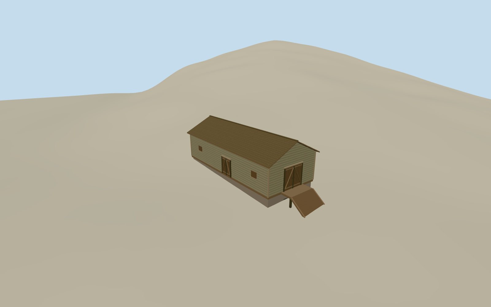

# Fort Témiscamingue Trade Store

The western trade store at Fort Témiscamingue, with a long light timber shell and simple cargo openings.

Authoring state: **review-in-qa.json**. Current completion evidence is in [qa.json](qa.json) and the [completion ledger](../../../../qualla-structures/batches/qualla-003.PROGRESS.md).

- [Fort Temiscamingue: Where the Cedars Dance at the Narrows](https://qualla.com/fort-t-miscamingue/)

Parks Canada identifies the trade store in the southwest part of the historic site. This asset uses the mapped diorama as an approximate historical registration and scale reference.

The long unadorned volume and gable proportions are interpreted from the distant 1876 public-domain photograph. Door arrangement, roof covering and grade-adapted sill are estimates.

The original Terrarium field is modern, with a slope across the uphill end. Footing height is adapted to the unchanged source field.

Build: `node content/worldgen/source/places/f0/f0r/fort_temiscamingue_trade_store/models/generate-fort-temiscamingue-trade-store.mjs`. Add `--check` to verify exact regeneration. 712 triangles; 4 materials; no embedded photographs.
