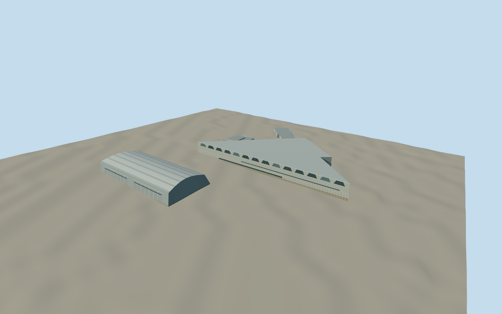

# Canada Aviation and Space Museum

Canada Aviation and Space Museum at Rockcliffe Airport in April 2024, with its delta exhibition hangar, low visitor and theater addition and separate curved-roof aircraft reserve hangar.

Authoring state: **review-in-qa.json**. Current completion evidence is in [qa.json](qa.json) and the [completion ledger](../../../../qualla-structures/batches/qualla-003.PROGRESS.md).

- [Canada Aviation and Space Museum](https://qualla.com/canada-aviation-and-space-museum/)

OpenStreetMap sets four current envelopes including the auditorium part. The delta deck and clerestory profiles of the main hangar are estimated from the older cleared Qualla airfield photographs.

The 2024 cleared photo shows partial exterior finishes. Entrance canopy, window spacing, visitor and service roof transitions and the location of reserve glazing and sliding doors are estimates based on native plans and written project descriptions.

The authoring model represents April 2024. Aircraft, parking and airfield vehicles, signs, interior exhibitions and neighboring airfield buildings are outside its scope.

The frozen airport terrain establishes local contact; foundations bridge the small grade differences. Floor elevations and access apron grades are approximate.

Build: `node content/worldgen/source/places/f2/f24/canada_aviation_and_space_museum/models/generate-canada-aviation-and-space-museum.mjs`. Add `--check` to verify exact regeneration. 1806 triangles; 5 materials; no embedded photographs.
