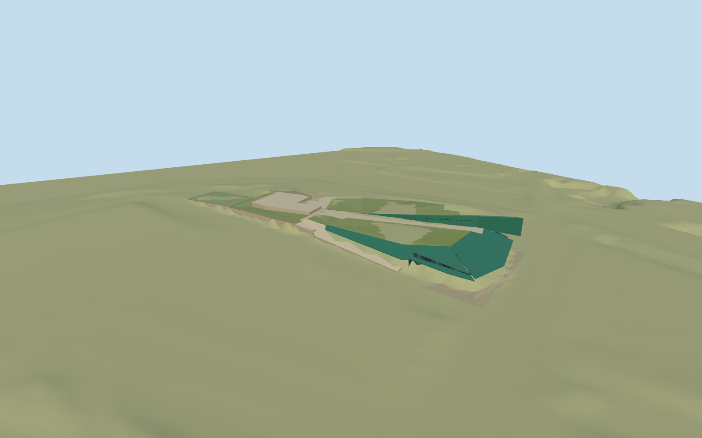

# Canadian War Museum

Ottawa’s Canadian War Museum with walkable grass slopes, canted concrete and glass, and a rising copper fin with bilingual Morse windows.

Authoring state: **review-in-qa.json**. Current completion evidence is in [qa.json](qa.json) and the [completion ledger](../../../../qualla-structures/batches/qualla-003.PROGRESS.md).

- [Canadian War Museum](https://qualla.com/canadian-war-museum/)

The 24.5 m peak is documented. Roof slopes use measured first-return samples, with localized interpretation at steps, narrow windows and parapets below the lidar resolution.

Curtain-wall subdivisions, concrete seams, copper panel widths and Morse aperture positions are approximated. The bilingual words encoded on the north fin are documented.

The exterior represents the standing museum with finished grass roofs and public terrace. The archive photo was taken during construction. Site hoardings, unfinished roof surfaces and current exhibition objects are outside the modeled scope.

Build: `node content/worldgen/source/places/f2/f24/canadian_war_museum/models/generate-canadian-war-museum.mjs`. Add `--check` to verify exact regeneration. 2078 triangles; 7 materials; no embedded photographs.
