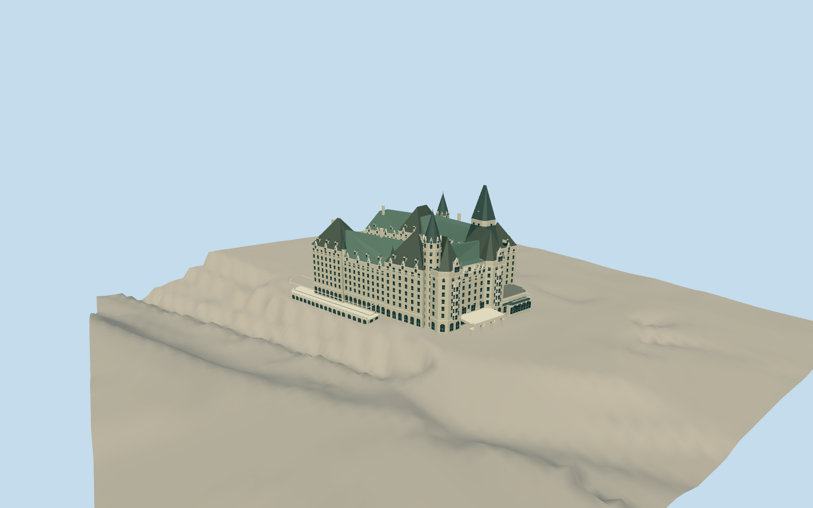

# Château Laurier

Indiana-limestone railway hotel with historic U-shaped wings, steep individual copper roofs, octagonal entrance pavilions and tall rear tower, inset round turrets, corbelled cornices, three-arch portico and low canal terrace.

Authoring state: **review-in-qa.json**. Current completion evidence is in [qa.json](qa.json) and the [local 100 ledger](../../../../qualla-structures/batches/PROGRESS.md).

- [Chateau Laurier](https://qualla.com/ch-teau-laurier/)

Historic 1912/1929 exterior interpreted from individually inspected Qualla 2008/2012 front and canal photographs, NCC phase/aerial study, existing west elevation in the 2020 heritage-impact report, mapped roof facets and satellite context.

Mapped ridge heights of 39/45 m and 64 m main tower are approximate and agree with the existing hotel depiction beside dimensioned proposed buildings. The drawing does not provide a measured hotel survey.

Fine heraldic carving, exact room-by-room openings, hidden service elevations, roof intersections and terrace limits remain simplified. Lower central halls are retained; no interiors or proposed modern addition, removed garage, separate canal buildings or landscaping.

Unmodified independent NRCan ground data retains the canal drop; host runtime terrain may differ. Footprint suppression remains disabled.

Photo pixels are not embedded. Copper tone follows the dated daylight images; weathering may differ today.

Build: `node packages/worldgen/scripts/generate-authored-places.mjs --ids=chateau_laurier`. Add `--check` to verify exact regeneration. 53105 triangles; 3 materials; no embedded photographs.
