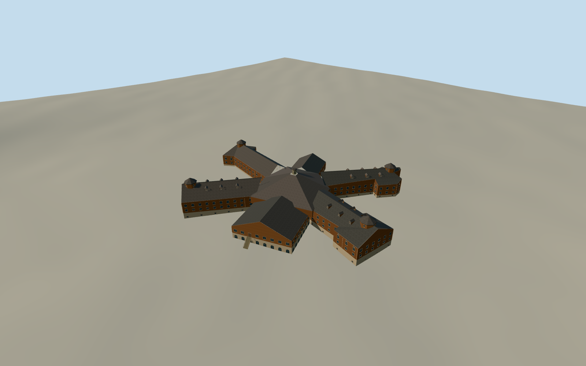

# Château Montebello

Château Montebello’s cedar-log hotel with its hexagonal rotunda, guest wing turrets, riverside dining room and stone lower level.

Authoring state: **review-in-qa.json**. Current completion evidence is in [qa.json](qa.json) and the [completion ledger](../../../../qualla-structures/batches/qualla-003.PROGRESS.md).

- [Chateau Montebello](https://qualla.com/ch-teau-montebello/)

The full hotel is mapped. The postcard gives a clear riverside view of the dining room and Wing C. Rear details, roof heights, cupolas and opening spacing are approximate.

The independently mapped convention center, sports facilities, stables, marina and manor are outside this asset.

Build: `node content/worldgen/source/places/f2/f24/chateau_montebello/models/generate-chateau-montebello.mjs`. Add `--check` to verify exact regeneration. 37314 triangles; 7 materials; no embedded photographs.
