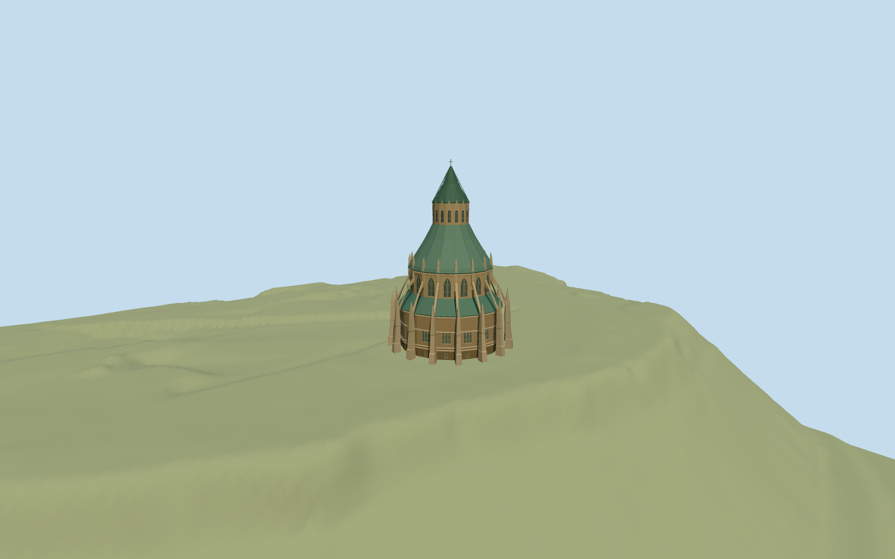

# Library of Parliament

Ottawa’s Victorian Gothic Library of Parliament, with 16 flying buttresses, pointed sandstone windows, radiating copper roof, ornamented lantern and spire.

Authoring state: **review-in-qa.json**. Current completion evidence is in [qa.json](qa.json) and the [completion ledger](../../../../qualla-structures/batches/qualla-003.PROGRESS.md).

- [Library of Parliament](https://qualla.com/library-of-parliament/)

The original library rotunda and its immediately attached connector are modeled as their own exterior. Centre Block, Peace Tower and temporary rehabilitation equipment remain outside this scope.

The native outline controls location and width. The height to the finial uses the OSM survey tag as an estimate. Carved tracery, individual sculptures and secondary roof dimensions are simplified.

The 1877 engraving informs the surviving masonry details. The modeled roof is modern copper with green patina, following the federal heritage description.

Build: `node content/worldgen/source/places/f2/f24/library_of_parliament/models/generate-library-of-parliament.mjs`. Add `--check` to verify exact regeneration. 10643 triangles; 5 materials; no embedded photographs.
