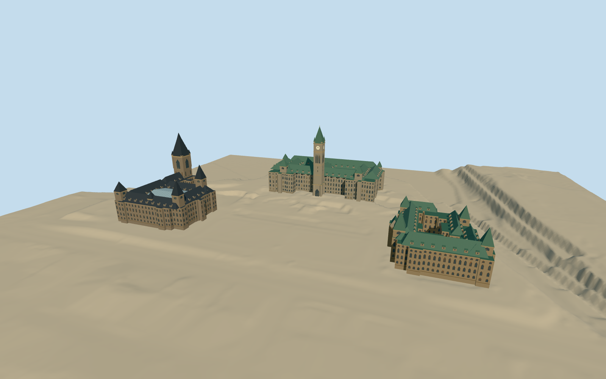

# Parliament Hill

Ottawa’s Parliament Hill precinct with the Centre Block, the 92.2 m Peace Tower, and the separate East and West blocks.

Authoring state: **review-in-qa.json**. Current completion evidence is in [qa.json](qa.json) and the [completion ledger](../../../../qualla-structures/batches/qualla-003.PROGRESS.md).

- [Parliament Hill](https://qualla.com/parliament-hill/)
- [Peace Tower](https://qualla.com/peace-tower/)

The model represents the permanent architecture of Centre, East and West blocks. Temporary scaffolding, temporary access, museum/interior contents, and garden monuments are outside scope.

Individual dormers, tracery, crenellations, side towers, courtyard facades, masonry pattern, the exact Library connector and rim transitions are approximate.

Library of Parliament is separately queued. The Peace Tower physical component links to both stories through this one model.

Build: `node content/worldgen/source/places/f2/f24/parliament_hill/models/generate-parliament-hill.mjs`. Add `--check` to verify exact regeneration. 30197 triangles; 6 materials; no embedded photographs.
