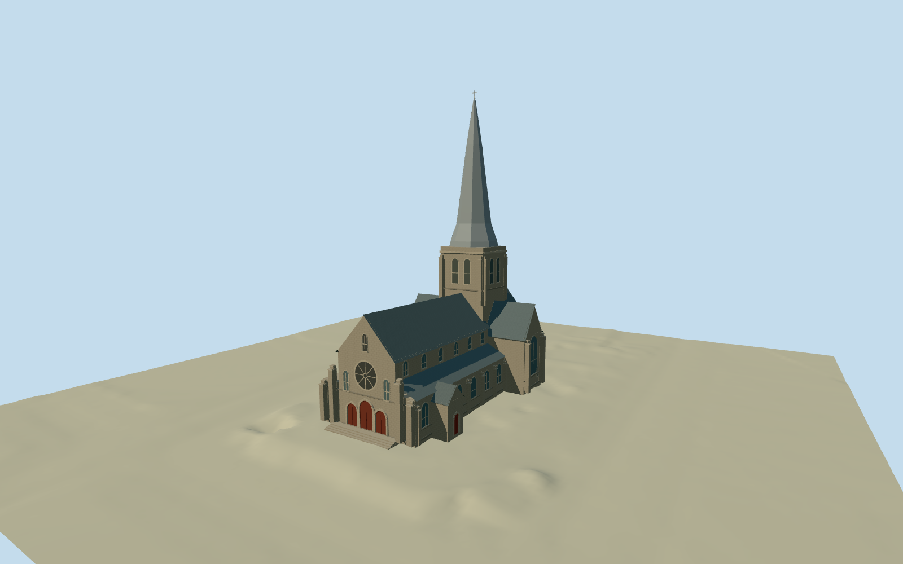

# Christ Church Cathedral (Montreal)

The standing Montréal cathedral with its limestone nave, lancets, crossing tower, aluminum spire and red triptych doors.

Authoring state: **review-in-qa.json**. Current completion evidence is in [qa.json](qa.json) and the [completion ledger](../../../../qualla-structures/batches/qualla-004.PROGRESS.md).

- [Christ Church Cathedral: The Church That Floats on Stilts](https://qualla.com/christ-church-cathedral-montreal/)

Draft exterior: approximate photographic proportions and simplified ornament. It is not a survey, photogrammetric reconstruction or approved current geographic replacement.

The published Detroit photograph shows the Gothic mass, gray stone, steep gables and spire taper. The cathedral records the three entrance arches, rose window, limestone recladding and lighter 1940 aluminum spire.

Terrain sampling/contact, geographic alignment and site activation remain pending. Runtime LODs are produced by the registered after-import pipeline and require visual review.

Reference photos remain in the local Qualla corpus; only provenance, paths and hashes are retained here.

Build: `node content/worldgen/source/places/f2/f25/christ_church_cathedral_montreal/models/generate-christ-church-cathedral-montreal.mjs`. Add `--check` to verify exact regeneration. 8962 triangles; 6 materials; no embedded photographs.
