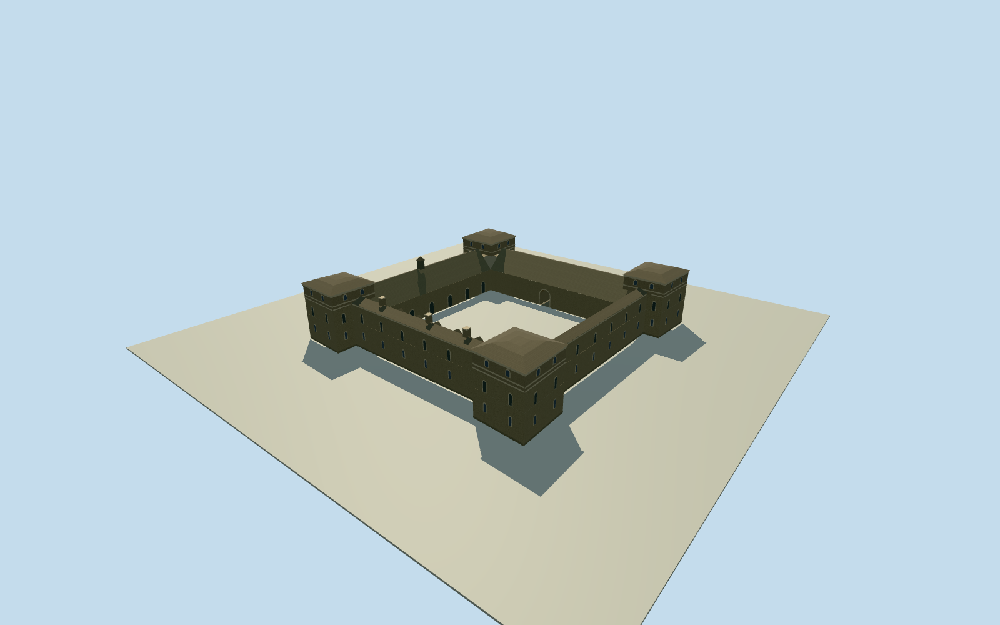

# Fort Chambly

Low cedar-shingled roofs and four projecting stone bastions enclosing Fort Chambly’s open courtyard.

Authoring state: **review-in-qa.json**. Current completion evidence is in [qa.json](qa.json) and the [completion ledger](../../../../qualla-structures/batches/qualla-003.PROGRESS.md).

- [Fort Chambly](https://qualla.com/fort-chambly/)

Represents the surviving stone fort photographed in June 2003. The outer and inner map rings set layout and scale.

Roof divisions, the landward gate, masonry detailing and individual grades are interpreted where no cleared view provided measurements.

Only the fort’s architecture is included. The historic-site park, detached exhibits and interiors are outside the model.

Original elevation remains provider-relative. Foundation details and exact local grades are approximate.

Build: `node content/worldgen/source/places/f2/f25/fort_chambly/models/generate-fort.mjs`. Add `--check` to verify exact regeneration. 3563 triangles; 5 materials; no embedded photographs.
