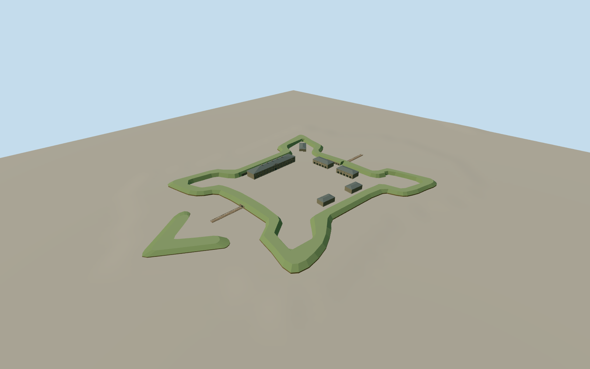

# Fort Lennox

Fort Lennox on Île aux Noix, with four grass-covered bastions around the open parade, the arcaded gate buildings, stone barracks, twin magazines, south ravelin and two bridges.

Authoring state: **review-in-qa.json**. Current completion evidence is in [qa.json](qa.json) and the [completion ledger](../../../../qualla-structures/batches/qualla-003.PROGRESS.md).

- [Fort Lennox](https://qualla.com/fort-lennox/)

The model represents the standing historic park with the four earthen bastions and open parade, original exterior buildings, ravelin and bridges. Earlier fortifications, movable objects and private interiors are outside the scope.

The raw terrain is preserved. The berm cross sections and stone gate lintels, bridge deck heights, casemate openings and building heights are modest estimates constrained by the native feature geometry and federal heritage records.

The 1923 photo describes the surviving palette only in grayscale. Roof and stone colors are estimates. Modern visitor infrastructure and historic activities are outside the scope.

Build: `node content/worldgen/source/places/f2/f25/fort_lennox/models/generate-fort-lennox.mjs`. Add `--check` to verify exact regeneration. 4445 triangles; 7 materials; no embedded photographs.
