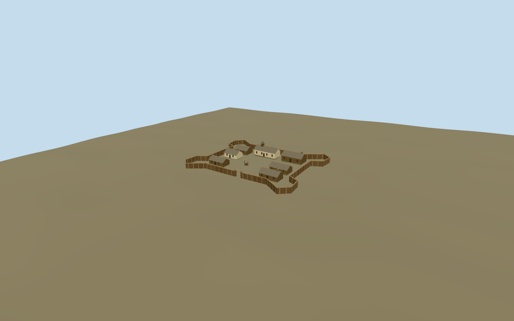

# Fort Ville-Marie

Circa-1660 Fort Ville-Marie at Pointe à Callière, with a timber stockade, four bastions, yard, chapel, and representative early settlement buildings.

Authoring state: **review-in-qa.json**. Current completion evidence is in [qa.json](qa.json) and the [completion ledger](../../../../qualla-structures/batches/qualla-003.PROGRESS.md).

- [Fort Ville-Marie](https://qualla.com/fort-ville-marie/)

The four-corner outline and overall area follow the museum’s modern archaeological findings. Specific corners, gate, heights, internal areas and the Saint-Pierre river shoreline are interpretations.

Bourdon documents an early scheme of uncertain date. Morin’s 1884 illustration is retrospective. Only Morin’s illustration provides visual clues. The McGill text reports architectural functions from the Bourdon manuscript.

The ancient occupation level was approximately two metres below the present street in the excavated area. The model shows the historical fabric in a dated geographic preview using today’s unmodified terrain datum. No modern shoreline or archaeological terrain was sculpted.

Build: `node content/worldgen/source/places/f2/f25/fort_ville_marie/models/generate-fort-ville-marie.mjs`. Add `--check` to verify exact regeneration. 8767 triangles; 6 materials; no embedded photographs.
