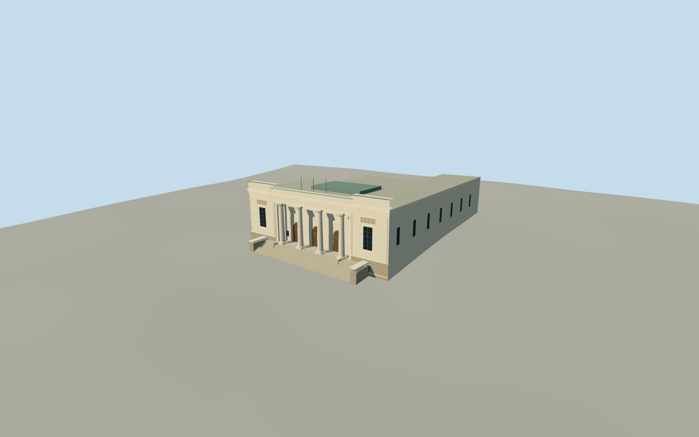

# Michal and Renata Hornstein Pavilion

The 1912 white Vermont marble Hornstein Pavilion with a four-column Ionic portico, oak arches and the monumental Sherbrooke Street stair.

Authoring state: **review-in-qa.json**. Current completion evidence is in [qa.json](qa.json) and the [completion ledger](../../../../qualla-structures/batches/qualla-003.PROGRESS.md).

- [Montreal Museum of Fine Arts](https://qualla.com/montreal-museum-of-fine-arts/)

Mapped footprint and street axes set position and extent. Unmeasured façade and roof heights, grade transitions and tertiary architectural details are estimates.

The selected CC0 image establishes the principal frontage. Other elevations are reconstructed from the footprint and published design facts.

The underlying campus elevation samples and raw source tiles stay unchanged. The individual base is an approximate fit to the local grade.

Build: `node content/worldgen/source/places/f2/f25/montreal_museum_hornstein_pavilion/models/generate-montreal-museum-hornstein-pavilion.mjs`. Add `--check` to verify exact regeneration. 2486 triangles; 6 materials; no embedded photographs.
