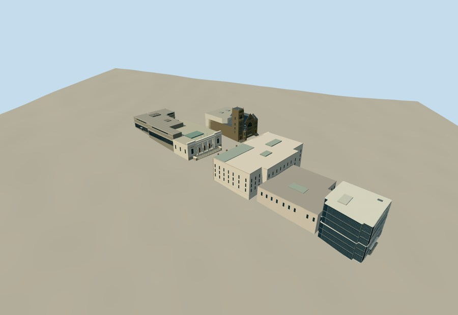

# Montreal Museum of Fine Arts

Five independent exteriors sit on both sides of Sherbrooke Street West. The Hornstein and Stewart pavilions share a mapped boundary. Bourgie Hall preserves the former Erskine and American Church, Desmarais includes the retained New Sherbrooke street front, and the Pavilion for Peace anchors the southern end of the campus.

The assembly uses the unchanged 512 m elevation field. Models use their own geographic placements and locally sampled ground elevations. Secondary elevations, roof equipment, and grade transitions are approximate. The documented museum inventory, native footprints and public-domain images guide the reconstruction.

[Montreal Museum of Fine Arts story](https://qualla.com/montreal-museum-of-fine-arts/)

Regenerate the assembly with `node content/worldgen/source/places/f2/f25/montreal_museum_of_fine_arts/generate-collection-scene.mjs`. Use `--check` to verify the current assembly.
