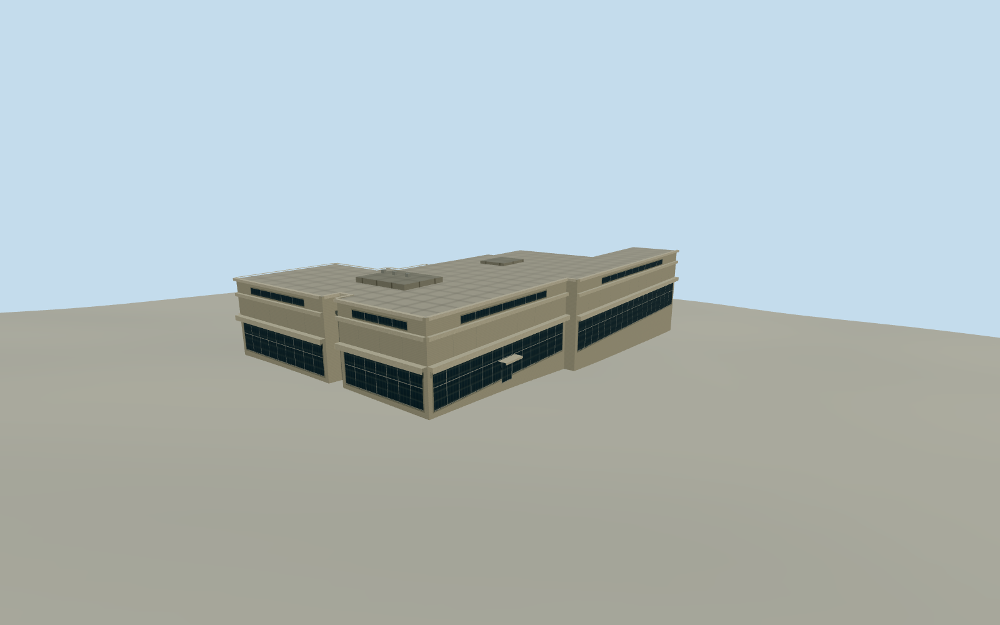

# Liliane and David M. Stewart Pavilion

Fred Lebensold’s 1976 Stewart Pavilion, a connected Brutalist addition with horizontal concrete slabs and recessed gallery glazing.

Authoring state: **review-in-qa.json**. Current completion evidence is in [qa.json](qa.json) and the [completion ledger](../../../../qualla-structures/batches/qualla-003.PROGRESS.md).

- [Montreal Museum of Fine Arts](https://qualla.com/montreal-museum-of-fine-arts/)

Mapped footprint and street axes set position and extent. Unmeasured façade and roof heights, grade transitions and tertiary architectural details are estimates.

Native geometry and documented architectural facts guide the exterior. Secondary elevations and finish details are estimated from the written record.

The underlying campus elevation samples and raw source tiles stay unchanged. The individual base is an approximate fit to the local grade.

Build: `node content/worldgen/source/places/f2/f25/montreal_museum_stewart_pavilion/models/generate-montreal-museum-stewart-pavilion.mjs`. Add `--check` to verify exact regeneration. 670 triangles; 5 materials; no embedded photographs.
