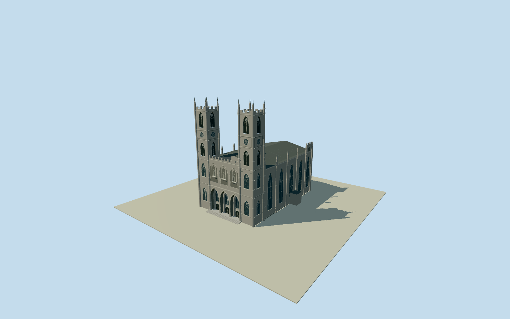

# Notre-Dame Basilica, Montreal

Principal Montreal limestone Gothic Revival basilica: twin square65m towers with paired lancets,louvres,rose windows,octagonal corner colonnettes,crenels and eight slender pinnacle tips; deeply recessed triple entrance portico,three statuary niches with robed saints,blind pointed arcade and central cross; low-pitched copper main roof,four wide transomed nave bays per side,raised rear end bay,roofline pinnacles,lower masonry,basement entrance canopy and raised east-tower door/stair. Native western low projection remains estimated. Rear Sacred Heart chapel,adjacent seminary,interiors,scaffolding,banners and street scenery excluded.

Authoring state: **medium-fi-exterior-bounded-preview-review-in-qa**. Current completion evidence is in [qa.json](qa.json) and the [local 100 ledger](../../../../qualla-structures/batches/PROGRESS.md).

- [Notre-Dame Basilica (Montreal)](https://qualla.com/notre-dame-basilica-montreal/)

Photo-directed medium-fi exterior,not a survey,scan or navigable interior. Fine Gothic carving,tracery,louvre slats and statue anatomy simplified; side articulation follows primary CPRQ photos;western hidden details,vestibule height and rear interface remain estimates.

Foundation publishes65m body length,37m width and65m towers above forecourt. Native40.8m facade includes tower/buttress projections. Main65m rear interface explicitly inferred within103m merged parent; rear chapel and dependencies excluded. No whole-parent footprint replacement.

Published65m tower height used as approximate pinnacle bound.29m main eave,33m low roof ridge,lower floor/base and all facade levels are photographic estimates.

Original NRCan bare-earth ground and dry pavement reference remain unchanged. Primary side photos establish a missing lower masonry storey,basement doorway/canopy,raised entrance stair and roofline articulation. Fixed lower-storey/subgrade foot-5.2m,crypt door floor-3.2m and main floor+.6m are architectural approximations,not terrain-derived per-vertex fitting. Bounded source-ground contact must pass current QA before activation;no pad or cutout.

Two accepted local originals control facade/colour;three primary CPRQ full side/rear photos control lower masonry,side bays,pinnacles and copper roof. Temporary scaffolds,banners,night illumination,adjacent seminary,forecourt monuments,traffic and interiors excluded. Photos are inspected controls,not redistributed texture pixels; shared material graphs.

Build: `node packages/worldgen/scripts/generate-authored-places.mjs --ids=notre_dame_basilica_montreal`. Add `--check` to verify exact regeneration. 34914 triangles; 6 materials; no embedded photographs.
