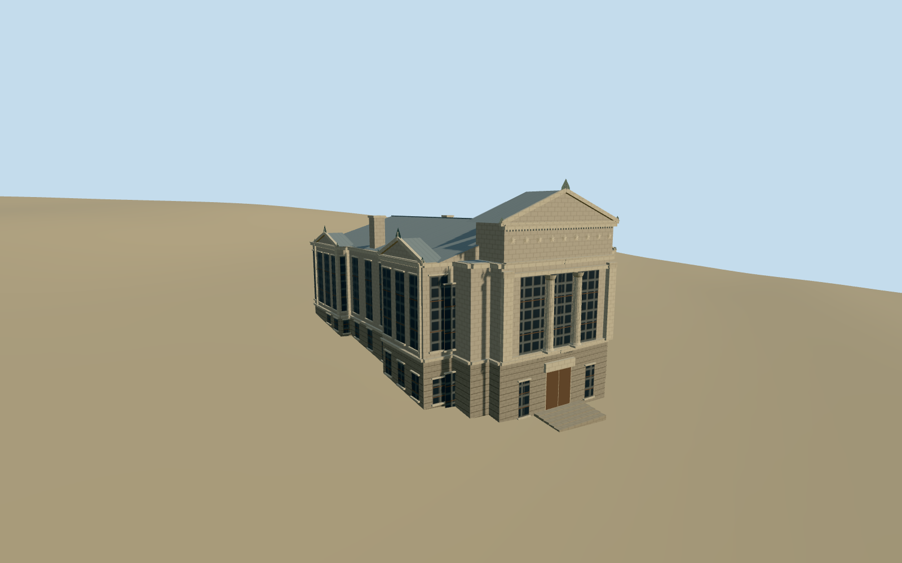

# Redpath Museum

McGill’s standing 1882 Redpath Museum, with a limestone Classical Revival portico raised over a banded base, side pediments, tall windows, and the rounded glazed rear gallery.

Authoring state: **review-in-qa.json**. Current completion evidence is in [qa.json](qa.json) and the [completion ledger](../../../../qualla-structures/batches/qualla-003.PROGRESS.md).

- [Redpath Museum](https://qualla.com/redpath-museum/)

The standing entrance, side porticoes and rounded rear gallery are modeled from the mapped footprint, an independently matched public-domain photograph, and published architectural facts.

Roof and gutter joints, stair elevations, metal details and the exact carved leaf and floral decoration are approximations. Modern banners, temporary works, neighboring buildings and interior exhibits are outside the model.

Build: `node content/worldgen/source/places/f2/f25/redpath_museum/models/generate-redpath-museum.mjs`. Add `--check` to verify exact regeneration. 7545 triangles; 6 materials; no embedded photographs.
