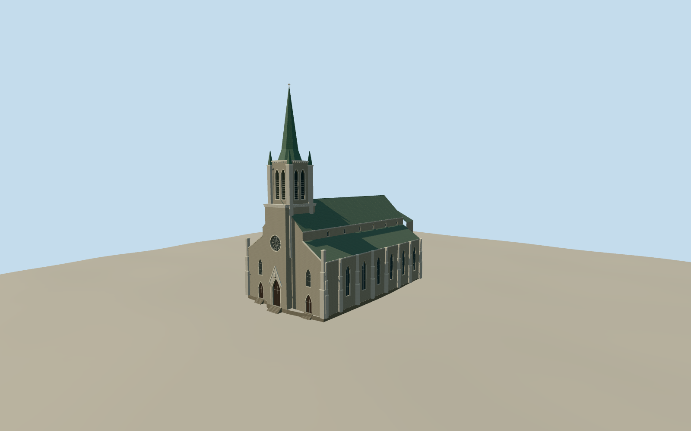

# St. Patrick's Basilica, Montreal

Montréal greystone Gothic Revival basilica with three pointed portals, a rose window, a copper spire and a rounded apse.

Authoring state: **review-in-qa.json**. Current completion evidence is in [qa.json](qa.json) and the [completion ledger](../../../../qualla-structures/batches/qualla-003.PROGRESS.md).

- [St. Patrick's Basilica, Montreal](https://qualla.com/st-patrick-s-basilica-montreal/)

The single circa-1895 stereograph shows the main front through trees. Unseen side and apse details follow the building inventory and mapped envelope. Stone and copper colors are estimates.

The church and spire use the documented material and overall proportions. Precise tracery, statues and small ornaments are simplified.

The original composite elevation field was retained. The historic ground registration is approximate.

The reconstruction covers the church and attached porch. The adjacent buildings, garden, fence and detached gate are outside the modeled footprint.

Build: `node content/worldgen/source/places/f2/f25/st_patrick_s_basilica_montreal/models/generate-montreal-st-patricks.mjs`. Add `--check` to verify exact regeneration. 14471 triangles; 6 materials; no embedded photographs.
