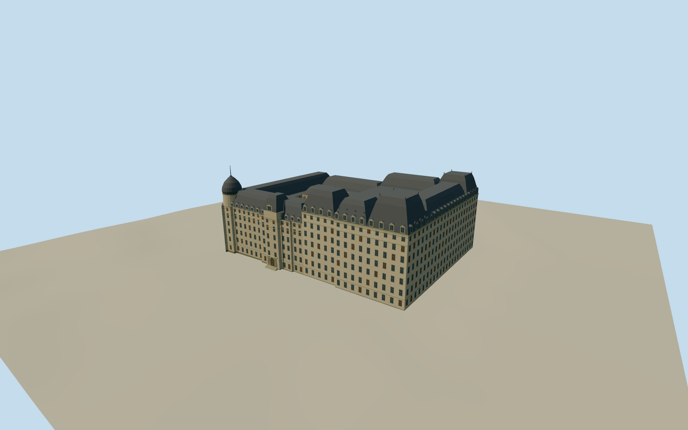

# Windsor Hotel (Montreal)

The intact circa-1912 Windsor Hotel in Montreal, with its Second Empire corner dome, the taller Cypress annex, mansard roofs and two open service courts.

Authoring state: **review-in-qa.json**. Current completion evidence is in [qa.json](qa.json) and the [completion ledger](../../../../qualla-structures/batches/qualla-003.PROGRESS.md).

- [The Windsor Hotel: Where Canada Learned to Be Grand](https://qualla.com/windsor-hotel-montreal/)

The surviving annex corners locate the historic atlas plan. The original hotel and open service courts are traced at approximately 1:1200. Fine setbacks, roof sections, window bays and the largely undocumented courtyard elevations are interpreted.

The archival photograph is monochrome. The limestone, dark slate and metal finishes use approximate colors. Interior rooms and neighboring buildings are outside the model.

The dated placement represents circa 1912. Ground elevations use the unchanged original modern Terrarium field. Historic thresholds are approximate.

Build: `node content/worldgen/source/places/f2/f25/windsor_hotel_montreal/models/generate-windsor-hotel.mjs`. Add `--check` to verify exact regeneration. 11608 triangles; 5 materials; no embedded photographs.
