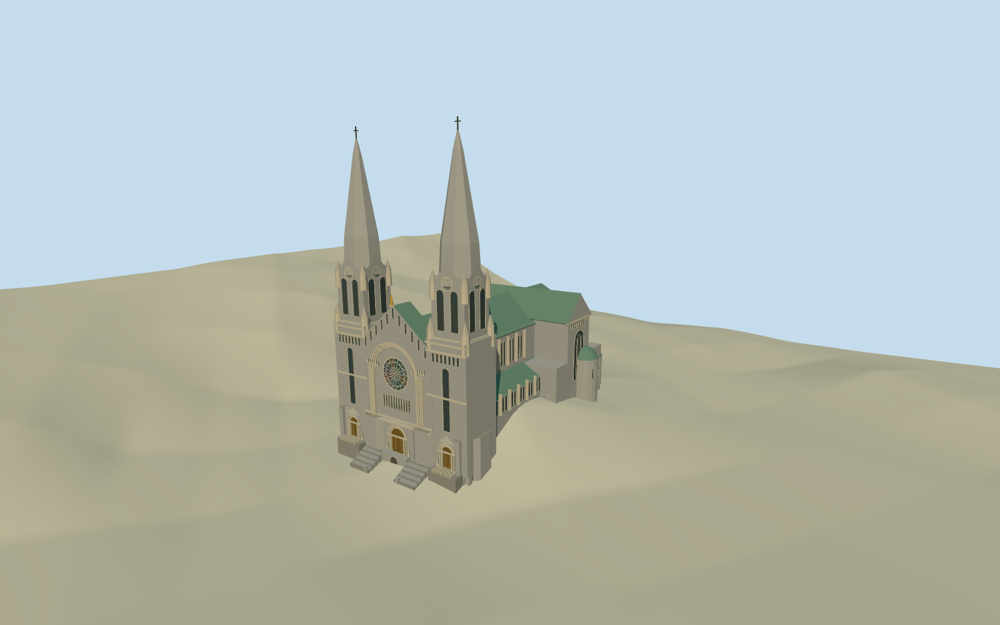

# Basilica of Sainte-Anne-de-Beaupré

The standing Sainte-Anne-de-Beaupré basilica with two octagonal spires, nested arches, rose window, silver granite, green copper roofs and a ten-chapel ambulatory.

Authoring state: **review-in-qa.json**. Current completion evidence is in [qa.json](qa.json) and the [completion ledger](../../../../qualla-structures/batches/qualla-004.PROGRESS.md).

- [Basilica of Sainte-Anne-de-Beaupre](https://qualla.com/basilica-of-sainte-anne-de-beaupr/)

Only the standing exterior is represented. Individual bronze-door reliefs and figurative sculptures are suggested in geometry. The glass patterns, side buttress returns and roof details are simplified.

The basilica annexes, plaza sculpture and earlier buildings on the sanctuary property are separate structures.

Build: `node content/worldgen/source/places/f2/f2m/basilica_of_sainte_anne_de_beaupre/models/generate-basilica-of-sainte-anne-de-beaupre.mjs`. Add `--check` to verify exact regeneration. 20097 triangles; 6 materials; no embedded photographs.
