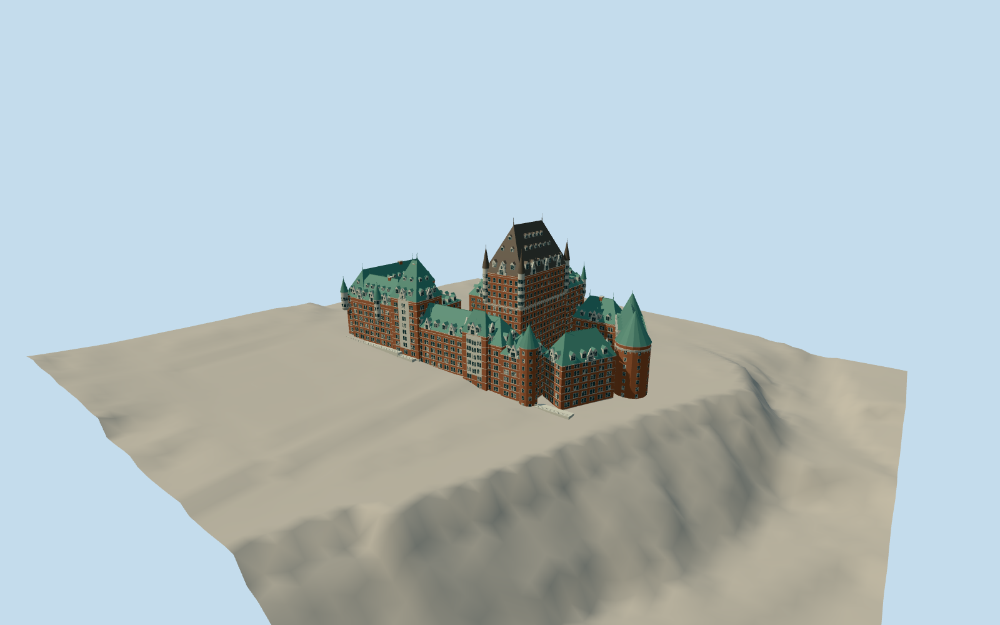

# Château Frontenac

Red-brick château hotel with Maxwell tower, cylindrical stone corner turrets, layered copper roofs and dormers, two open courts, a through-arched Saint-Louis entrance and stepped connected wings.

Authoring state: **review-in-qa.json**. Current completion evidence is in [qa.json](qa.json) and the [local 100 ledger](../../../../qualla-structures/batches/PROGRESS.md).

- [Chateau Frontenac](https://qualla.com/ch-teau-frontenac/)

Original medium-fi surviving exterior interpreted from three individually inspected 2013–2016 Qualla photographs, the 1927 ground-floor plan, CIEQ phase silhouette, heritage descriptions and mapped roof parts.

Central tower height follows the 77 m architectural record approximately; official tourism rounds to 80 m. Individual storeys, roof junctions, hidden service elevations and sculptural ornament are photographic interpretations, not a measured survey.

Later western ranges are represented by massing; interiors, whole Dufferin promenade, separate kiosks, landscaping and later unverified rooftop changes are excluded.

Independent NRCan DTM retains real southwest rise and river cliff. Small hotel terraces are simplified; runtime terrain may differ. Footprint suppression remains disabled.

No photograph pixels embedded; roof colors preserve the differing copper patina visible in the dated references.

Build: `node packages/worldgen/scripts/generate-authored-places.mjs --ids=chateau_frontenac`. Add `--check` to verify exact regeneration. 46146 triangles; 4 materials; no embedded photographs.
