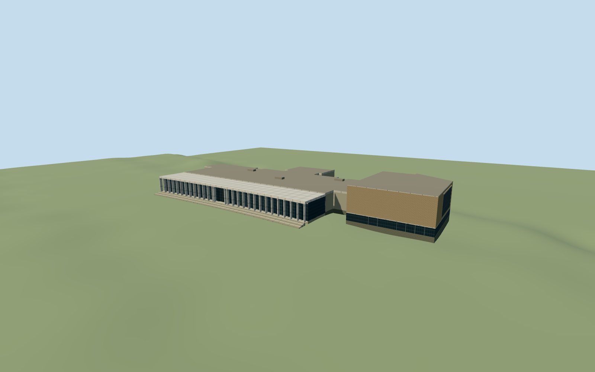

# Beaverbrook Art Gallery

Beaverbrook Art Gallery’s low stone galleries and two modern additions. A gently curved precast colonnade fronts the glazed Harrison McCain Pavilion on Queen Street.

Authoring state: **review-in-qa.json**. Current completion evidence is in [qa.json](qa.json) and the [completion ledger](../../../../qualla-structures/batches/qualla-003.PROGRESS.md).

- [Beaverbrook Art Gallery](https://qualla.com/beaverbrook-art-gallery/)

The 2005 photo shows older portions before the two latest expansions. The new pavilions follow the named current footprint and the architects’ written descriptions.

The curvature, number and thickness of the entrance fins, east pavilion apertures, exact roof heights and smaller back-of-house details are estimated.

The model represents the gallery itself. Nearby artwork and the Legislative Assembly across Queen Street are outside the building scope.

Build: `node content/worldgen/source/places/f8/f80/beaverbrook_art_gallery/models/generate-beaverbrook-art-gallery.mjs`. Add `--check` to verify exact regeneration. 3741 triangles; 6 materials; no embedded photographs.
