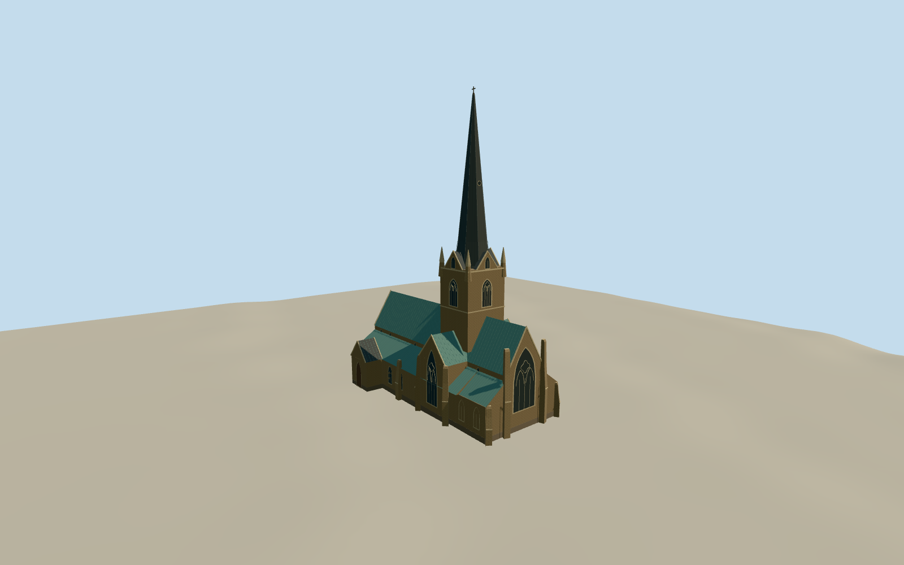

# Christ Church Cathedral (Fredericton)

The sandstone Christ Church Cathedral in Fredericton has steep oxidized metal roofs, Gothic tracery and a dark 198-foot crossing spire.

Authoring state: **review-in-qa.json**. Current completion evidence is in [qa.json](qa.json) and the [completion ledger](../../../../qualla-structures/batches/qualla-003.PROGRESS.md).

- [Christ Church Cathedral, Fredericton](https://qualla.com/christ-church-cathedral-fredericton/)

The cathedral’s east elevation, tower and sanctuary are based on the verified Qualla viewpoint. Windows and doors on less documented elevations approximate the materials and shapes of the current building.

The wall height, leaded glass motifs, pinnacles, roof trim and discrete approach landing heights are estimated.

The adjacent parish hall, trees and interiors are outside the exterior model.

Build: `node content/worldgen/source/places/f8/f80/christ_church_cathedral_fredericton/models/generate-christ-church-cathedral-fredericton.mjs`. Add `--check` to verify exact regeneration. 8728 triangles; 6 materials; no embedded photographs.
