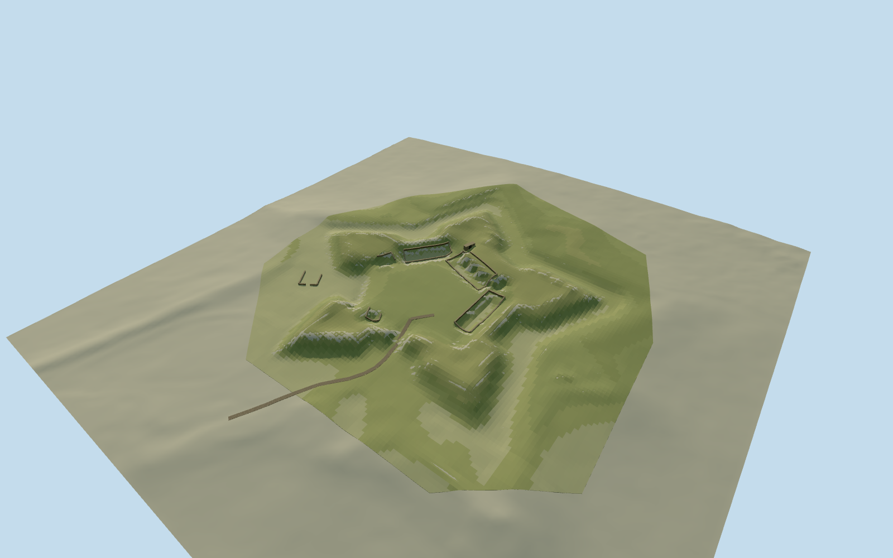

# Fort Beauséjour

Fort Beauséjour–Fort Cumberland as it survives in Aulac, including its five grass banks, surrounding ditch, exposed stone foundations and recessed magazine.

Authoring state: **review-in-qa.json**. Current completion evidence is in [qa.json](qa.json) and the [completion ledger](../../../../qualla-structures/batches/qualla-004.PROGRESS.md).

- [Fort Beausejour](https://qualla.com/fort-beausejour/)

Draft exterior: approximate photographic proportions and simplified ornament. It is not a survey, photogrammetric reconstruction or approved current geographic replacement.

Original bare-earth elevation preserves the extant rampart slopes. The Canadian designation record and current named map ways identify the low foundations, powder magazine and stone retaining segments.

Terrain sampling/contact, geographic alignment and site activation remain pending. Runtime LODs are produced by the registered after-import pipeline and require visual review.

Reference photos remain in the local Qualla corpus; only provenance, paths and hashes are retained here.

Build: `node content/worldgen/source/places/f8/f84/fort_beausejour/models/generate-fort-beausejour.mjs`. Add `--check` to verify exact regeneration. 26195 triangles; 4 materials; no embedded photographs.
