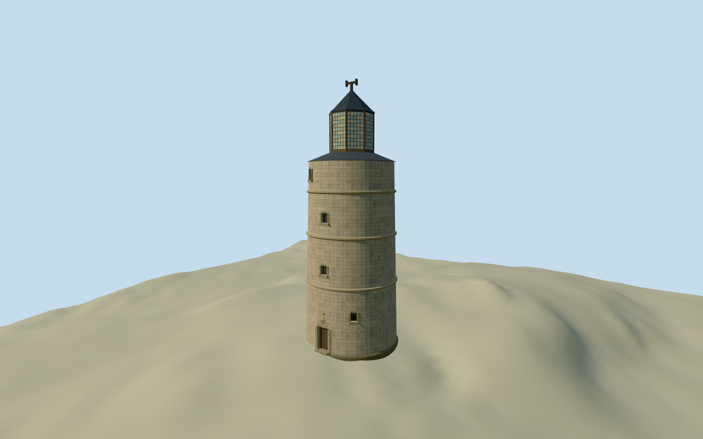

# Louisbourg Lighthouse

First French lighthouse on Louisbourg Head, with a tapering circular stone tower, a glazed timber lantern and a slate cap as drawn in the original plan.

Authoring state: **review-in-qa.json**. Current completion evidence is in [qa.json](qa.json) and the [completion ledger](../../../../qualla-structures/batches/qualla-004.PROGRESS.md).

- [Louisbourg Lighthouse](https://qualla.com/louisbourg-lighthouse/)

Represents the original pre-fire tower shown by the drawing. The keeper’s house and later towers are outside the asset.

Door bearing, minor openings around the back, materials and glazing colors are approximated from the historic sheet. The modeled 400 panes are distributed as five columns and ten rows across eight faces.

Ground is modern bare-earth elevation; it does not recover the eighteenth-century surface.

Build: `node content/worldgen/source/places/f8/f8j/louisbourg_lighthouse/models/generate-louisbourg-lighthouse.mjs`. Add `--check` to verify exact regeneration. 9526 triangles; 7 materials; no embedded photographs.
