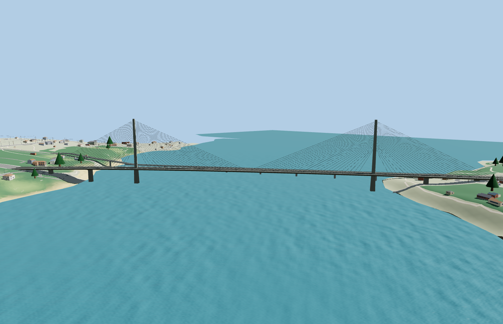

# Pont de l’Iroise

Two slim concrete pylons and a single central plane of stays carry the four-lane N165 across the Élorn. A pale fascia, dark box girder, separate approach piers and restrained road furniture follow the mapped deck and exterior photographs.

The Q3397237 OSM deck outline and the two named PMTiles N165 carriageways identify the bridge. The signed deck crosses southeast from Le Relecq-Kerhuon to Plougastel-Daoulas. The independent Albert Louppe crossing retains its own map geometry. The original N165 bridge returns when the model fails to load. Native water, terrain and the separate downstream crossing remain.

The 19,424-triangle source rebuilds byte for byte. The first two runtime tiers total 212,300 bytes. Six GLBs validated and 36 current views were inspected.

The retained outline defines the full 876.5 m crossing and the two mapped N165 carriageways. The catalog’s 800.05 m structural length is a separate measurement. Pylon stationing, road camber, box-girder section and cable anchorage spacing are approximated from exterior photographs and the mapped plan. The standard elevation grid fixes approach grades. The southeast deck end is skewed to meet the offset N165 lanes. Local viewer water uses standard terrain and does not model tides.

Rebuild with `node packages/worldgen/scripts/generate-vushtrri-stone-bridge.mjs`. Append `--check` to compare exact bytes. Use `--ids=vushtrri_stone_bridge` for targeted import, LOD, placement and readiness.
