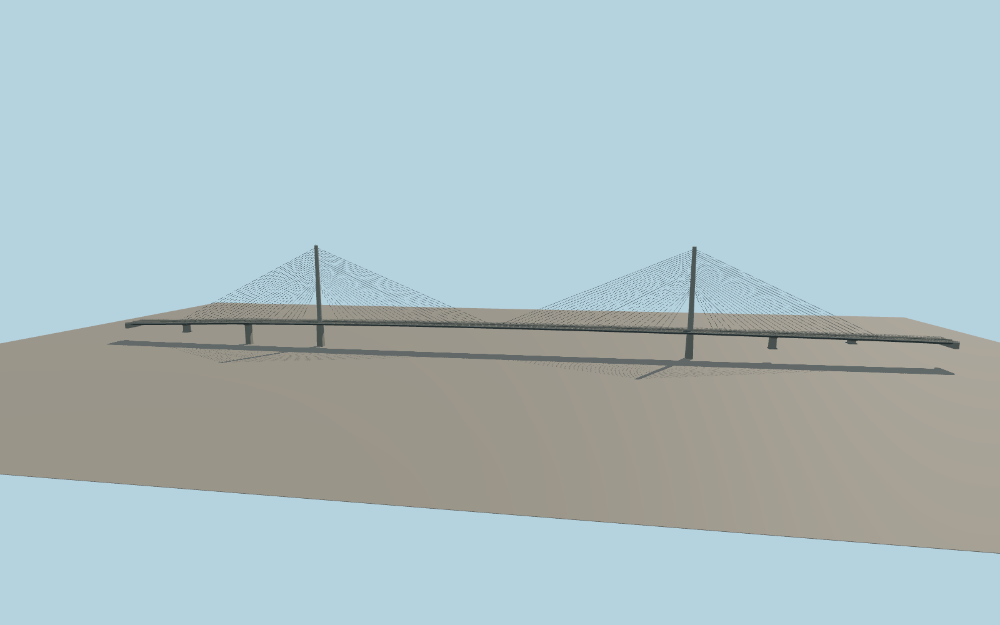

# Pont de l’Iroise

Two slim concrete pylons and a single central plane of stays carry the four-lane N165 across the Élorn. A pale fascia, dark box girder, separate approach piers and restrained road furniture follow the mapped deck and exterior photographs.

Run `node packages/worldgen/scripts/generate-pont-de-liroise.mjs` to rebuild the source master. Append `--check` to compare the exact bytes. Use `--ids=pont_de_liroise` for targeted import, LOD generation and placement.

The retained outline defines the full 876.5 m crossing and the two mapped N165 carriageways. The catalog’s 800.05 m structural length is a separate measurement.

Pylon stationing, road camber, box-girder section and cable anchorage spacing are approximated from exterior photographs and the mapped plan. The standard elevation grid fixes approach grades.

The southeast deck end is skewed to meet the offset N165 lanes. Local viewer water uses standard terrain and does not model tides.

Original geometry follows the repository license. Map data is © OpenStreetMap contributors under ODbL-1.0 via Protomaps. Terrain samples are described in terrain-grid.json. Ordinary pictures stay local and are not redistributed or used as textures. Current acceptance is recorded in qa.json.
