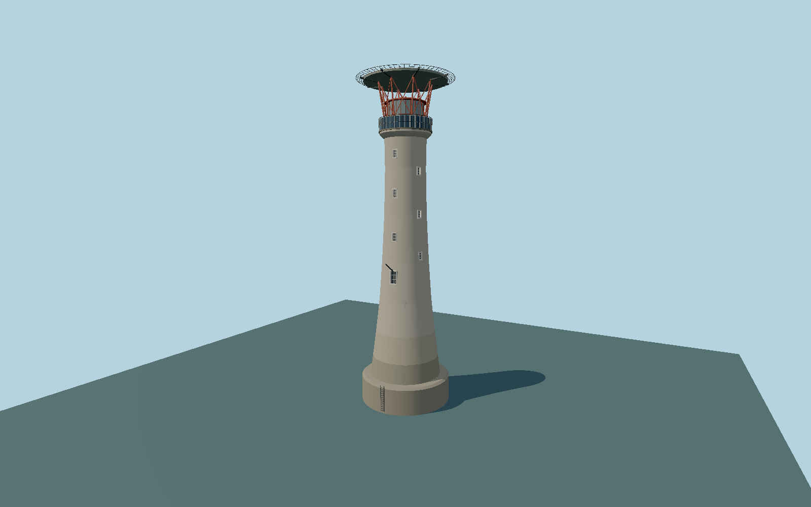

# Eddystone Lighthouse — eddystone_lighthouse

1882 curved granite sea tower with staggered recessed windows, dark photovoltaic gallery apron, red lantern support cage and modern above-lantern helideck with radial safety net.

## Identity and evidence

Exact catalog identity **Q546122**. Source facts: `{"heightMeters":49,"year":1882,"lightHeightAboveMeanHighWaterMeters":41,"basis":"Trinity House current exterior and height; 41 m focal datum is distinct from 49 m structure height. Exact-QID map point and credited photographer views guide viewer placement; operator table coordinate discrepancy remains explicit."}`. The source specification keeps published dimensions separate from reconstructed details.

- https://www.trinityhouse.co.uk/lighthouses-and-lightvessels/eddystone-lighthouse
- https://www.trinityhouse.co.uk/asset/952/view/1200
- https://trinityhouse.co.uk/asset/5623/download?1746607918=

Original geometry and shared procedural materials. Official photographs are research references only; no reference imagery or third-party mesh is embedded or redistributed.

## Authored geometry and materials

24,268 triangles, 45,428 vertices, 5 surface groups; 1,929,888 source bytes. SHA-256: `sha256:2c3719ce88618358e4a74722c1ea2db13fc3505454356ea677da7c3cc6221c14`. Actual bounds: -7.325, 0.000, -7.325 to 7.325, 49.022, 7.325 m.

Shared canonical material graphs with metric UV repeats in extras.molenSurface; portable glTF PBR factors and vertex colors remain. Dark recesses/lantern panels retain local fallback materials. Shared references: `matgraph:molen.worldgen.material.stone_ashlar` (2.4 × 1.5 m), `matgraph:molen.worldgen.material.metal_painted` (2 × 2 m), `matgraph:molen.worldgen.material.stone_granite` (2 × 2 m), `matgraph:molen.worldgen.material.wood_plain` (2 × 0.25 m). Model-native axes: {"up":"+Y","front":"+Z","origin":"Authored main tower center at local base level; attached ensembles are offset from this origin."}.

## Placement proposal

Mapped viewer anchor is preferred for map alignment; operator table discrepancy remains unresolved and is not silently labelled survey truth. Door/hoist azimuth is a photo-quadrant reconstruction +/-25 degrees. Old Smeaton stump and reef are not part of this single-tower asset. No surveyed footprint, exact landing orientation, present tide or submerged foundation is claimed. +Y up; +Z entrance/hoist faces reconstructed south-southwest quadrant, approximately 202 degrees true, +/-25 degrees. The circular tower has no main plan axis. Visible modeled base meets the host sea-level review plane. This is a visual datum convention, not surveyed reef elevation, mean-high-water conversion, tide or bathymetry. Proposed anchor -4.2680422, 50.1837523 (longitude, latitude), heading -0.3839724354387525 radians. Elevation policy: **sea-level**. This is a reviewable proposal, not a completed site-fit certification. Ground models require terrain contact; offshore models also require water-datum and base-height checks.

## Limitations and review

- The modeled exterior follows the cited published facts and inspected photographs. Unpublished dimensions and local fittings are explicitly photo-proportioned; no claim of engineering survey accuracy is made.
- Portable PBR and shared metric surfaces are provided. Surface weathering, material color under local lighting and fine facade relief require close render review before maximum-detail acceptance.
- Current granite tower exterior and modern service deck are included. Old Smeaton stump and surrounding rocks are separate site features and are not included in this asset. Intermediate radii, glazing, panel subdivisions and helideck members are photo-proportioned.

Near/far fixtures are in `spec.qaCameras`. Float32 finite geometry, triangle degeneracy and winding are checked by the generator. Current rendering, shared-material, maximum-fidelity and geographic review results are recorded in `qa.json` and the readiness ledger; source generation alone does not approve a model.

Regenerate with `node packages/worldgen/scripts/generate-lighthouse-models.mjs --ids=eddystone_lighthouse`; add `--check` for reproducibility. Editable component recipes are in `packages/worldgen/scripts/lighthouse-offshore-models.mjs`. The generator protects artist-edited master hashes and preserves import/capture/shared-capture/QA documents.
