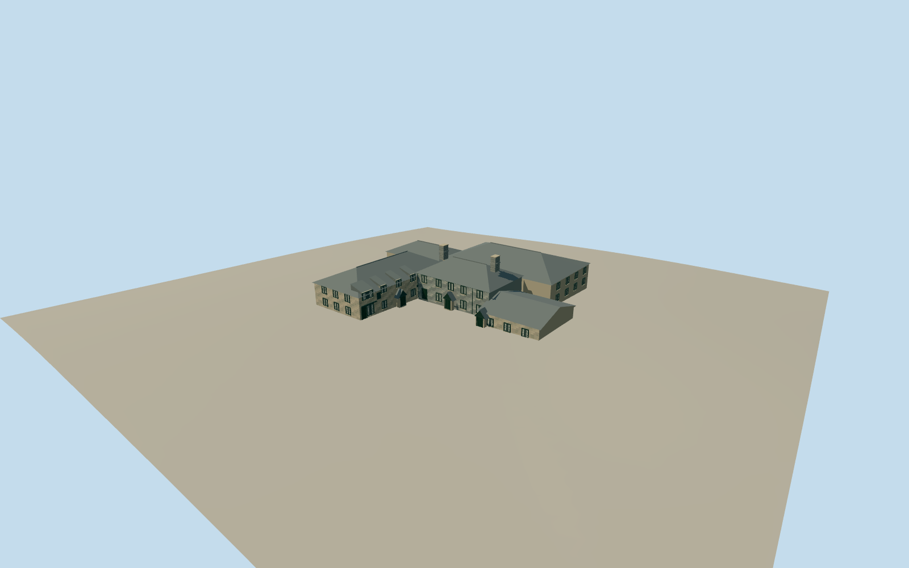

# Jamaica Inn

Historic slate-hung five-window bar range with twin chimney stacks and gabled porch; perpendicular granite museum/stables wing with eaves dormers, attached rear range and lower east connector.

Authoring state: **review-in-qa.json**. Current completion evidence is in [qa.json](qa.json) and the [local 100 ledger](../../../../qualla-structures/batches/PROGRESS.md).

- [Jamaica Inn](https://qualla.com/jamaica-inn/)

Original medium-fi exterior based on individually inspected local 2008–2010 photographs, Historic England architectural description and mapped roof layout.

Main facade and axial chimneys are slate-hung; original geometry and color courses represent this distinct cladding. Shared granite, roof slate and timber surfaces are bound; glass and vertical slate cladding use separate local materials.

Modern long east hotel wing and far rear service wing excluded. Rear elevations, roof joins, heights and fine stonework remain approximate; interiors, signs and temporary furniture excluded.

Independent Terrarium elevations are preserved without flattening; ground contact and foundations remain host-dependent rather than surveyed.

Build: `node packages/worldgen/scripts/generate-authored-places.mjs --ids=jamaica_inn`. Add `--check` to verify exact regeneration. 8905 triangles; 5 materials; no embedded photographs.
