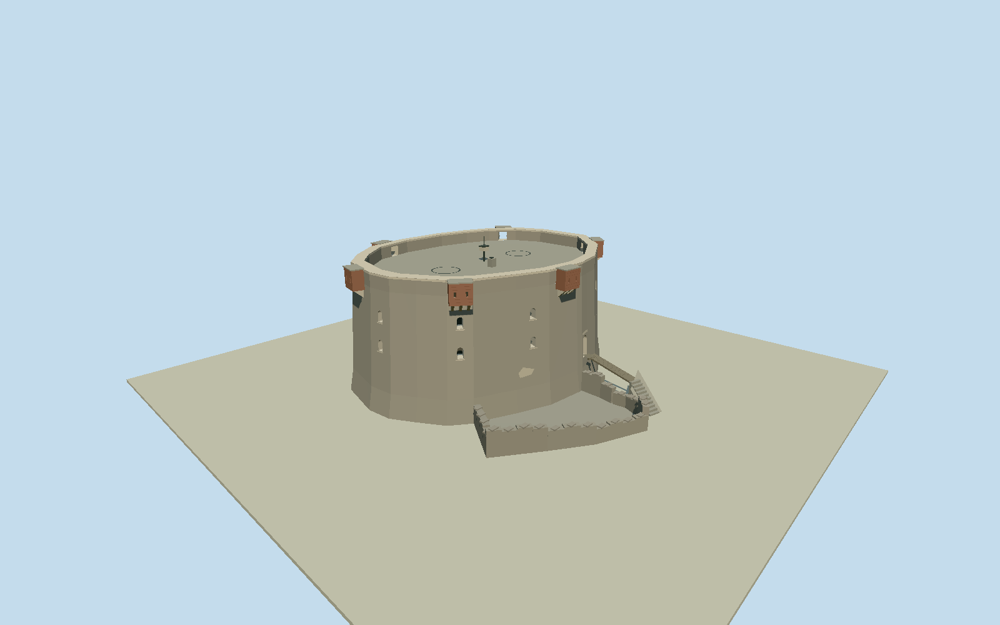

# Bréhon Tower

Whole surviving Bréhon sea fort: full22vertex native oval battered granite tower,13vertex physically attached low entrance ruins/shared5nodes,6vertex concrete entry landing, immediate short wooden entrance bridge and10steps. Two levels of small round-headed southern windows/first-floor southern portal, deliberately blank upper north wall with low WWII embrasure, plain thick parapet/open roof gun platform,6projecting brick loopholed machicolations/corbels, surviving crane pedestal/low gun-base traces and small modern seamark beacon. Exclude wholeislet/naturalrock/reef/sea, detachedlandingpier/remoteaccesspaths, ships/Jethou/background, historiccannons/lostroofbuildings/interiors. Warmgrayrubblegranite/paleashlararchedreveals/mutedredbrickdefenceboxes. Preserveovalasymmetry/batteredprofile/realdeepwindowapertures/blanknorthface/southentry/flatopenroof/plainparapet. Ruinslowandunroofed, immediateentrybridgeand10concretesteps follow nativeplan; no genericcircularcrenellatedmedievaltower. Finehiddenroof/ruindetail and exactheight estimates.

Authoring state: **review-in-qa.json**. Current completion evidence is in [qa.json](qa.json) and the [completion ledger](../../../../qualla-structures/batches/qualla-002.PROGRESS.md).

- [Bréhon Tower](https://qualla.com/brehon-tower/)

Native named historic way522604715/Q4981832, all22towerpoints; attached ruin1523593882/all13points shares5towernodes. Immediate landing1523593887/all6points, bridge1523593889 sharesmain-towernode13888664149, and10stepway1523593888 form intrinsic entrance access. Detachedpier1523593884/isletcoastline550354790 excluded. FixedQualla anchor[-2.4883,49.4713], heading0.2861801781864177 from polygon-area majoraxis before terrain/geometry, local+XapproximatelyENE/+ZtowardsSSEentry. Nativefoot~28x22m, upperwall~26x20m after estimatedbatter consistentwithTownie26x20m account, not precise surveyedfootprint. Door/windowpositions/batter/heights/ruincrown/hiddenroof traces estimated independently of terrain.

Wholeovalfort22points/13pointattachedlowruin/6pointlanding/shortbridge/10steps represented. Sixbrickmachicolations and blankuppernorthwall follow primary2011sitevisit account. Southernwindowpositions/ruincrown/heights/doorlandingextension/rooftraces/beacon minorgeometry estimated. Openings have deep darksimplifiedinteriorclosures; interiors and exact internalvaults excluded.

Two exactpublishedManvyiPD-self2010/2011originals individuallyinspected/nativeSHA1bound. Distantviews do not certify hiddenrooffine detail or everywindow. OfficialparishTownie2013textfacts only; protectedPDFphotos/plans notviewed orused. No metadata/category/articlebody/policychange, protectedphototexture/generatedbitmap/downloadedmesh.

Bodybatteredtoe0..2.2m/top10.9m/parapet12.2m/beacon13.4m/door3.1m/tensteps2.2m/lowruin1.15..2.3m are independent architecturalestimates; Libraryreported~40ft notcurrentheight survey. Upperbody26x20m approximately matches parishtext; coarse nativebase28x22m retained.

Independent256m129square2m all16641samples/oneoriginalTerrariumtile/PNG frozen unchanged beforegeometry. Provider sea-valuedfield is allzero and DOES NOT resolve actualrock/islet/tide; no terrainfitting/flattening/reacquisition or fabricatedisletmesh. Nativebottomstep fixesY0 but actualcompatiblehostcontact unverified. Ordinarygeographicpreview/replacementdisabled.

Separatelandingpier/wholeislet/naturalrock/reef/sea/Jethou/ships/background/oldguns/lostroofbuildings/generalremoteaccesspaths excluded. Lowroofmountings/crane pedestal are simplified approximate surviving traces, not complete artillery reconstruction.

Build: `node packages/worldgen/scripts/generate-authored-places.mjs --ids=brehon_tower`. Add `--check` to verify exact regeneration. 2639 triangles; 6 materials; no embedded photographs.
