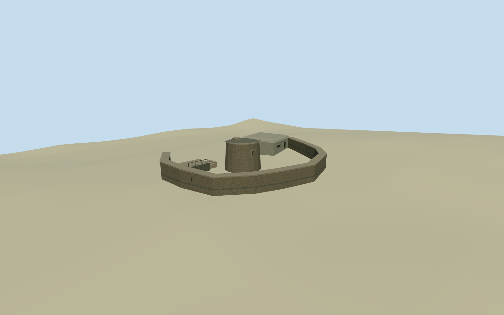

# Fort Hommet

Stone Martello tower, curving enclosure and the weathered concrete exterior on Guernsey’s Vazon Bay headland.

Authoring state: **review-in-qa.json**. Current completion evidence is in [qa.json](qa.json) and the [completion ledger](../../../../qualla-structures/batches/qualla-004.PROGRESS.md).

- [Fort Hommet](https://qualla.com/fort-hommet/)

Models the visible main fort core. Outlying ruins, fixtures and interiors are outside scope.

Roof openings, small stonework and the elevation of separate parts are approximate. Mapzen data resolves the broad headland grade.

Build: `node content/worldgen/source/places/gb/gby/fort_hommet/models/generate-fort-hommet.mjs`. Add `--check` to verify exact regeneration. 611 triangles; 5 materials; no embedded photographs.
