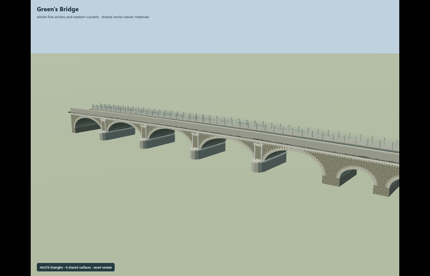
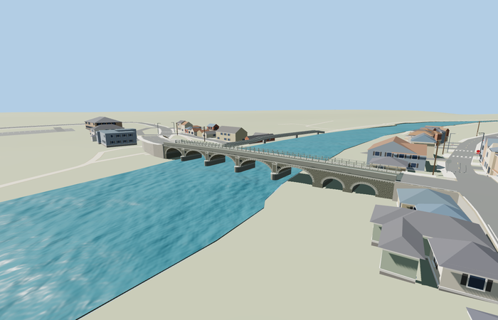

# Green's Bridge

Reviewed2026-10-29. **Complete medium-fi static exterior and approximate native placement.**

Inspected73 current frames:11 portable,10 shared-material asset stage,27 medium-fi/context/LOD and25 native PMTiles views. Five open main ellipses, two smaller eastern culverts, all four projecting piers and downstream pedimented panels, long/short radial arch stones,dentil course, continuous crowned road and asymmetric modern north walkway/guards are complete. Near details aggregate with distance. Current native paving-probe frames are pixel-identical to all25 inspected native acceptance frames; the extra probe distinguishes paving from an outer guard top without changing the rendered model.

Four existing shared256px graphs: stone_drywall on irregular rubble spandrels, stone_limestone_raw on modeled arch/pier/parapet elements, concrete_plain on the modern north ledge and separately dark-tinted road, metal_painted on guards. A local marking material supplies double yellow lines. Metric UVs and linear sRGB-derived vertex tints; no embedded/private images. Concrete grain approximates asphalt. Shared textures load once and all model/support geometries unload. Source/local contextY0 is distinct from the separately reviewed native water origin.

| Level | Triangles | Bytes | Draws |
| --- | ---: | ---: | ---: |
| skyline | 752 | 57880 | 1 |
| district | 3432 | 287808 | 6 |
| street | 10656 | 895804 | 6 |
| closeup | 26112 | 2186152 | 6 |

Detailed source 44676 triangles,5364892bytes. Browser triangles 752 / 3432 / 10656 / 26112, bytes 57880 / 287808 / 895804 / 2186152, draws 1 / 6 / 6 / 6. Initial skyline+district 345688bytes. Separate GPU position/normal streams. All seven barrels,continuous road,north walk and south parapet remain in every tier; panels,guards,barrel joints and dentils aggregate with distance. No physical device timing claim.

Exact-QID way771298878 supplies the77.419m footprint. Named current PMTiles bridge35184400136370 spans61.310m across the main five arches, with ground-tagged Green Street continuation over the eastern culverts; distinct north path35184481062220 corroborates the asymmetric walk. Anchor[-7.253556384,52.658058525], heading0.415705173223: +X ENE/east bank/New Road; -X WSW/west bank/Green Street; +Z SSE/downstream toward Saint Francis Bridge and the ornate face; -Z NNW/upstream and modern north walk. Native origin45.76926803588867m follows this viewer water plane. Dimensions of hidden culverts/upstream noses and all vertical sections remain photo/map approximations.

All five loaded tiers retain110 building records,148 independent road records,the original159 raw road records,DEM,displayed terrain and water. The named bridge record is replaced (159to158), while its north path and directly connected Green Street continuation are clipped and graded. Twelve road/path width probes have actual model paving; maximum difference0.124235m reflects the modeled12cm north-walk curb, while road-center joins are within4mm. The unfiltered top ray under one guard also records its1.23m rail top; separate rays below railing height verify the paving. Coarse native bank grades,large automatic retaining faces and culvert ground cover are visible approximations. The independent Saint Francis Bridge and other mapped crossings/boardwalks remain. Failed loading retains all159 road records. Unloading releases all model/support geometry; no ground/building/water cutout.

## Reconstruction limits

- Original static medium-fi reconstruction from ordinary pictures and current PMTiles. Exact-QID footprint77.419m includes the eastern extension; named current bridge road covers61.310m of the main crossing, with ground-tagged continuation across the eastern end. These differing records are retained, not conflated.
- Five open main elliptical barrels, four pedimented downstream pier panels and two smaller eastern culverts are complete geometry. Widths, pier centers, arch heights, hidden upstream cutwater profiles, culvert dimensions and deck grades are reconstruction controls, not a survey. Eastern culverts are partly obscured by native ground; no surveyed flood-channel excavation is introduced.
- Modern north deck/railings are asymmetric to the southern historic parapet. Small rail mesh, concrete ledge/corbels and eight-centimetre-style map tolerances are visualization approximations. Temporary flowers, graffiti, signs, lamps, neighboring buildings and independent Saint Francis Bridge/boardwalk are outside this source geometry.
- Native ground/water use ordinary viewer PMTiles and coarse Mapzen only. Water origin and approach grades are approximate; no flood, engineering, traffic or accessibility certification. No bespoke terrain download.
- Four existing256px dry-stone/limestone-raw/concrete/painted-metal graphs; no embedded/private images. Concrete graph tinted grey approximates asphalt grain; no new global material graph. Physical laptop/phone timings remain unmeasured.
- Native-fit.json and integration-review.json retain generation controls; current hash-bound acceptance is in qa.json and placement-report.json. Current map semantics and three ordinary photographs establish this static exterior, not engineering dimensions, current traffic legality or accessibility certification. Adjacent unique buildings, quays, modern bridges and their present-day structural condition are outside this model scope. Physical laptop/phone timings remain unmeasured.
