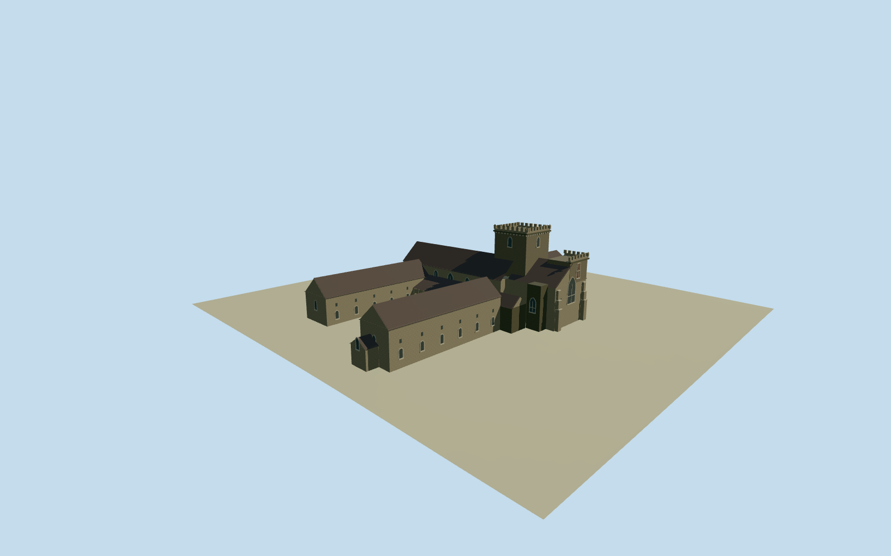

# Holycross Abbey

The lime-gray Cistercian abbey with crenellated tower, steep slate roofs and an open cloister.

Authoring state: **review-in-qa.json**. Current completion evidence is in [qa.json](qa.json) and the [completion ledger](../../../../qualla-structures/batches/qualla-004.PROGRESS.md).

- [Holy Cross Abbey](https://qualla.com/holy-cross-abbey/)

Tower height and individual window tracery and masonry joints are approximated from the exterior photographs.

The separately managed detached infirmary and other ruin structures are outside the attached church-and-cloister scope.

Build: `node content/worldgen/source/places/gc/gc6/holy_cross_abbey/models/generate-holy-cross-abbey.mjs`. Add `--check` to verify exact regeneration. 7871 triangles; 5 materials; no embedded photographs.
