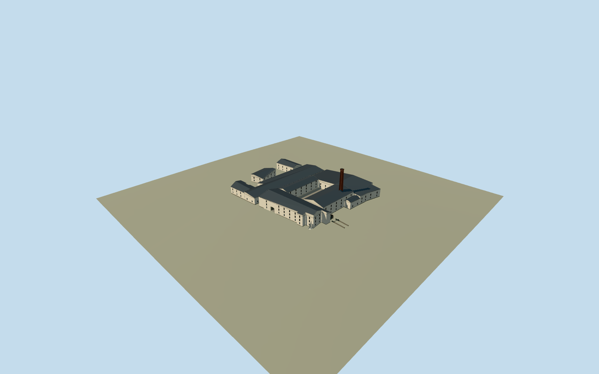

# Kilbeggan Distillery

Historic Kilbeggan Distillery with pale roughcast, slate ranges, open court, a red-brick chimney and the restored timber waterwheel on the River Brosna.

Authoring state: **review-in-qa.json**. Current completion evidence is in [qa.json](qa.json) and the [completion ledger](../../../../qualla-structures/batches/qualla-003.PROGRESS.md).

- [Kilbeggan Distillery](https://qualla.com/kilbeggan-distillery/)

The mapped range boundaries and wheel centre follow native survey features. The internal courtyard footprint, individual roof divisions, chimney position and height, and façade bays are estimated.

The open elevation field describes the site and surrounding gradients at its available sampling resolution. Narrow race walls, water level and local retaining structures are approximate. The model represents the north-bank historic museum ranges, with exhibits and the far-side warehouse annexes outside its scope.

Build: `node content/worldgen/source/places/gc/gc6/kilbeggan_distillery/models/generate-kilbeggan-distillery.mjs`. Add `--check` to verify exact regeneration. 7957 triangles; 7 materials; no embedded photographs.
